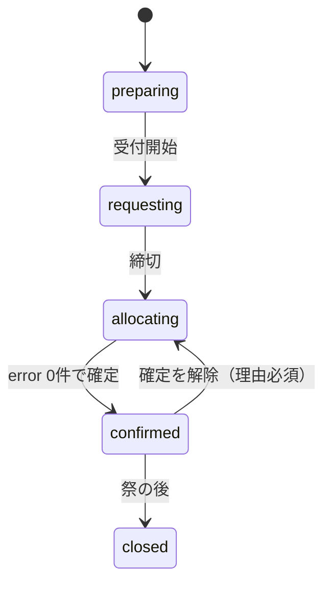

# データ設計

## 列挙型

Postgres の enum 型として作り、TypeScript の型は `supabase gen types` で生成する。団体代表はロールではなく、group_members の行で表す。団体代表の団体の中の立場（店長・副店長）は group_members.role（group_role）で表す。

```sql
create type year_status as enum ('preparing','requesting','allocating','confirmed','closed');
create type group_category as enum ('stall','department','company','rest_area');
create type room_kind as enum ('room','gym','outdoor','other');
create type app_role as enum ('admin','head','deputy_head','staff','viewer'); -- head・deputy_head は T15 の 0011 で admin の後に足す
create type group_role as enum ('manager','deputy_manager');                -- T15 の 0012
create type rule_kind as enum ('substitute','source_restrict','fixed_request','keep');
create type alloc_origin as enum ('auto','manual');
create type consent_status as enum ('not_asked','asked','accepted','declined');
create type festival_day as enum ('day_minus2','day_minus1','day1','day2');
create type delivery_kind as enum ('furniture','tent','weight','side_curtain');
create type delivery_status as enum ('pending','done','problem');
create type notice_audience as enum ('soumu','all_groups','groups');     -- T17 の 0014（お知らせの宛先）
create type event_kind as enum ('deadline','event');                     -- T18 の 0015（予定と締切の種類）
create type event_audience as enum ('soumu','groups','all');             -- T18 の 0015（予定と締切の対象）
```

| 型 | 値 | 表示名 |
| --- | --- | --- |
| year_status | preparing / requesting / allocating / confirmed / closed | 準備中 / 申請受付中 / 振り分け中 / 確定 / 終了 |
| group_category | stall / department / company / rest_area | 模擬店 / 部門 / 企業 / 休憩所 |
| room_kind | room / gym / outdoor / other | 部屋 / 体育館 / 屋外 / その他 |
| app_role | admin / head / deputy_head / staff / viewer | 管理者 / 総務部門長 / 総務副部門長 / 総務部門員 / 閲覧のみ |
| group_role | manager / deputy_manager | 店長 / 副店長 |
| rule_kind | substitute / source_restrict / fixed_request / keep | 代替 / 運び元の制限 / 固定の申請 / 残す |
| alloc_origin | auto / manual | 自動 / 手動 |
| consent_status | not_asked / asked / accepted / declined | 未依頼 / 依頼済み / 了承 / 拒否 |
| festival_day | day_minus2 / day_minus1 / day1 / day2 | 前々日 / 前日 / 1日目 / 2日目 |
| delivery_kind | furniture / tent / weight / side_curtain | 机等 / テント / 重し / 三方幕 |
| delivery_status | pending / done / problem | 未 / 済 / 問題あり |
| notice_audience | soumu / all_groups / groups | 総務内 / 全団体 / 指定の団体 |
| event_kind | deadline / event | 締切 / 予定 |
| event_audience | soumu / groups / all | 総務 / 団体 / 全員 |

app_role の head（総務部門長）と deputy_head（総務副部門長）は T15 で足した（D-48。deputy_head の権限は head と同じ）。`alter type … add value` で足した値は、同じトランザクションの中では使えないので、値を足すだけのマイグレーション（0011）を分け、値を使うのは 0013 からにする。group_role の店長と副店長も権限は同じで、表示名だけが違う。画面の表示名は T15b でこの表の名前にそろえた（T15b より前の画面は admin を「総務管理者」、staff を「総務部員」と出していた。head・deputy_head は T15b を出してから、管理者が招待で付ける。README の 5）。団体代表は、画面では「{団体名} の店長」「{団体名} の副店長」と出す（04「共通レイアウト」。D-50）。

## テーブル定義

マイグレーションは supabase/migrations に4桁の連番で置く。0001_init.sql（列挙型・表・ビュー）と 0002_triggers.sql（トリガー）は T02、0003〜0006（権限の関数・RLS・RPC）は T03、0007_auth.sql（auth.users のトリガーと Before User Created フック）は T04、0008_confirm_keep_both_ways.sql（確定の前の確認の E005 を両方向にする）は T07、0009_apply_invitations_keep_conflict.sql（別のロールを持つ人へのロールの招待を使用済みにしない。remove_role で本人あての未使用のロールの招待も取り消す）は T03 のマージの後の直しで作る。0010_rls_select_once.sql（行が多くなりうる表の select のポリシーを、判定関数を行ごとに呼ばない形にする。意味は変えない。D-47）は T14 の速さの改善で作る。0011_app_role_lead.sql（app_role に head・deputy_head を足すだけ）、0012_group_role.sql（group_role の型と group_members.role・invitations.group_role の列を足すだけ。今の関数のまま動く）、0013_role_overlap_lead_tier.sql（兼任の禁止〔適用の前の確かめ・invitations_group_role_check・トリガー〕と3つの段の判定関数・ポリシー・RPC。動きを変えるものは、古い関数とぶつからないように全部ここに入れ、1つのトランザクションで切り替える。D-48・D-49）は T15 で作る。0014_notices.sql（お知らせの宛先の型 notice_audience、表 notices・notice_groups とそのトリガー・RLS、RPC save_notice・delete_notice。足すだけで、今の表と関数は変えない。D-53）は T17 で作る。0015_events.sql（予定と締切の種類 event_kind・対象 event_audience の型、表 events とそのトリガー・RLS。書き込みは画面から直接〔RLS〕で、RPC はない。足すだけで、今の表と関数は変えない。D-54）は T18 で作る。本番に適用したファイルは書き換えず、次の番号のファイルを足す。created_at・updated_at は audit_logs を除く全テーブルに付け（下では省略）、トリガーで入れる（クライアントが送った値は使わない）。日時は timestamptz で保存し、画面では Asia/Tokyo で入力・表示する。

外部キーの on delete は次のとおりにする。年度・団体への参照は cascade（年度や団体を消すと、その下の行も消える）。場所・品目への参照は restrict（使われている場所・品目は消せない）。記録のためのユーザーへの参照（counted_by、updated_by、checked_by）は set null。年度と団体の両方を持つ表（allocations、deliveries、invitations）は、複合外部キー `(group_id, year_id) → groups (id, year_id)` で年度の一致を保証する。

文字列と数には上限を付ける。自由記述（note・memo・problem_note）は 2000 字、名前・表示名・ラベルは 100 字（年度名は 50 字）、コードと建物は 50 字、aliases は 20 個・合計 1000 字、rules.params は 20000 字、数（count）は 10000 まで。団体代表と部員も書ける列があるので、大きな値で無料プランの容量（500MB）を使い切らせず、解けない申請を入れさせないため。

```sql
-- 年度
create table years (
  id uuid primary key default gen_random_uuid(),
  label text not null unique check (btrim(label) <> '' and length(label) <= 50), -- 'R9'
  festival_start date not null check (festival_start between '2000-01-01' and '2200-12-31'), -- 1日目（有限で現実的な範囲。D-18）
  request_open_at timestamptz,
  request_close_at timestamptz,               -- 受付開始の前に入れる。requesting の間は null にできない
  status year_status not null default 'preparing',
  allocation_version int not null default 0,  -- 振り分けの入力と結果の版。allocating の間、関係する表が変わるたびにトリガーで増やす
  auto_allocated_at timestamptz,              -- 最後に自動振り分けを保存した日時
  prev_year_id uuid references years on delete set null, -- 複製元の年度（create_year_from が入れる）
  check (request_open_at is null or request_close_at is null or request_open_at < request_close_at)
);

-- 場所（年度をまたぐ）
create table rooms (
  id uuid primary key default gen_random_uuid(),
  name text not null unique check (btrim(name) <> '' and length(name) <= 100), -- '第一多目的室'
  aliases text[] not null default '{}' check (cardinality(aliases) <= 20 and length(array_to_string(aliases, '')) <= 1000),
  kind room_kind not null default 'room',     -- 体育館は gym、外N・正門周辺は outdoor
  building text check (length(building) <= 50), -- '1号棟'。outdoor は null
  floor smallint,                             -- outdoor は null
  is_storage boolean not null default false,  -- 在庫を数える保管場所か
  extra_cost smallint not null default 0 check (extra_cost between 0 and 20), -- 運び出しにくい部屋の追加コスト（CI5 など）。allocator の入力と同じ 0〜20
  sort_order int not null default 0
);

-- 年度ごとの場所の状態（行がなければ使用可）
create table room_years (
  year_id uuid references years on delete cascade,
  room_id uuid references rooms on delete restrict,
  usable boolean not null default true,
  note text check (length(note) <= 2000),
  primary key (year_id, room_id)
);

-- 品目（年度をまたぐ）
create table items (
  id uuid primary key default gen_random_uuid(),
  code text not null unique check (code ~ '^[a-z][a-z0-9_]*$' and length(code) <= 50), -- 'desk'。年度をまたぐキー
  name text not null check (btrim(name) <> '' and length(name) <= 100), -- '机(木)'
  aliases text[] not null default '{}' check (cardinality(aliases) <= 20 and length(array_to_string(aliases, '')) <= 1000), -- フォームでの表記 '{机(キャスター有)}'
  requestable_categories group_category[] not null default '{}', -- 申請できる区分。不可机・不可椅子は '{}'
  sort_order int not null
);

-- 在庫
create table stocks (
  year_id uuid references years on delete cascade,
  room_id uuid references rooms on delete restrict,
  item_id uuid references items on delete restrict,
  count int not null check (count between 0 and 10000),
  counted_by uuid references auth.users on delete set null, -- 書き込みのたびに DB が auth.uid() を入れる（counted_at も）
  counted_at timestamptz,
  primary key (year_id, room_id, item_id)
);

-- 団体
create table groups (
  id uuid primary key default gen_random_uuid(),
  year_id uuid not null references years on delete cascade,
  name text not null check (btrim(name) <> '' and length(name) <= 100), -- '2年2組'
  display_name text check (length(display_name) <= 100), -- '2年2組（カジノ）'
  aliases text[] not null default '{}' check (cardinality(aliases) <= 20 and length(array_to_string(aliases, '')) <= 1000), -- '{展示部門(2-2)}'
  category group_category not null,
  is_food boolean not null default false,
  location_room_id uuid references rooms on delete restrict, -- 使用場所。屋内・屋外は rooms.kind で判断。校内分散（美化など）は null
  sort_order int not null default 0,
  unique (year_id, name),
  unique (id, year_id)                        -- 年度の一致を複合外部キーで保証するための参照先
);

-- 年度ごとのロール（管理者・総務部門長・総務副部門長・総務部門員・閲覧のみ。1人に年度ごと1つ）
create table year_roles (
  year_id uuid references years on delete cascade,
  user_id uuid references auth.users on delete cascade,
  role app_role not null,
  primary key (year_id, user_id)
);
create index on year_roles (user_id);

-- 団体代表（1人で複数団体を持てる。同じ年度の部門のロールとは兼ねられない。D-49）
create table group_members (
  group_id uuid references groups on delete cascade,
  user_id uuid references auth.users on delete cascade,
  role group_role not null default 'manager', -- 店長・副店長（権限は同じ。人数の上限なし。T15 より前の行は店長）
  primary key (group_id, user_id)
);
create index on group_members (user_id);

-- 招待（1人に複数作れる。1行に1つの権限）
create table invitations (
  id uuid primary key default gen_random_uuid(),
  year_id uuid not null references years on delete cascade,
  email text not null check (email = lower(btrim(email)) and email ~ '^[^@[:space:]]+@[^@[:space:]]+$' and length(email) <= 254),
  role app_role,                              -- ロール（管理者・総務・閲覧のみ）として招待するとき
  group_id uuid,                              -- 団体代表として招待するとき
  group_role group_role,                      -- 団体代表として招待するときの立場（店長・副店長）
  used_at timestamptz,
  check ((role is null) <> (group_id is null)), -- 1行に1つ。両方なら2行作る
  check ((group_id is null) = (group_role is null)), -- 立場は団体の招待のときだけ（invitations_group_role_check）
  foreign key (group_id, year_id) references groups (id, year_id) on delete cascade
);
create index on invitations (email);
create index on invitations (group_id);
-- 未使用の招待は（年度・メール）にロール1つ、（年度・メール・団体）に1つ
create unique index on invitations (year_id, email) where role is not null and used_at is null;
create unique index on invitations (year_id, email, group_id) where group_id is not null and used_at is null;

-- 申請の提出（団体ごとに1つ）
create table request_submissions (
  group_id uuid primary key references groups on delete cascade,
  submitted_at timestamptz,                   -- 未提出は null。提出のたびに DB が now() にする（CSV の取り込みで admin が submittedAt を渡したときを除く。D-19）
  note text check (length(note) <= 2000),     -- 備考（数には影響しない）
  updated_by uuid references auth.users on delete set null -- DB が auth.uid() を入れる
);

-- 申請（品目ごとの数）
create table requests (
  group_id uuid references groups on delete cascade,
  item_id uuid references items on delete restrict,
  count int not null check (count between 0 and 10000),
  primary key (group_id, item_id)
);

-- ルール
create table rules (
  id uuid primary key default gen_random_uuid(),
  year_id uuid not null references years on delete cascade,
  code text not null check (btrim(code) <> '' and length(code) <= 50), -- 'S05'
  kind rule_kind not null,
  params jsonb not null check (jsonb_typeof(params) = 'object' and length(params::text) <= 20000), -- 形は03_allocation.md
  enabled boolean not null default true,
  memo text check (length(memo) <= 2000),
  unique (year_id, code)
);

-- 代替の了承（キャスター机交換など）
create table substitution_consents (
  group_id uuid references groups on delete cascade,
  from_item_id uuid references items on delete restrict,
  to_item_id uuid references items on delete restrict,
  count int check (count between 0 and 10000), -- 依頼したときの置き換え台数（団体に見せる）。set_consent で asked にしたとき RPC が入れる
  status consent_status not null default 'not_asked',
  note text check (length(note) <= 2000),
  primary key (group_id, from_item_id, to_item_id),
  check (from_item_id <> to_item_id)
);

-- 振り分け（振り分け表の1行）
create table allocations (
  id uuid primary key default gen_random_uuid(),
  year_id uuid not null references years on delete cascade,
  source_room_id uuid not null references rooms on delete restrict,
  group_id uuid not null,
  item_id uuid not null references items on delete restrict,           -- 実際に運ぶ品目
  requested_item_id uuid not null references items on delete restrict, -- 申請した品目（代替がなければ item_id と同じ）
  count int not null check (count between 1 and 10000),
  is_keep boolean not null default false,     -- 残す（運び元＝団体の使用場所）。保存する RPC が決める
  pinned boolean not null default false,      -- 自動実行で変えない
  origin alloc_origin not null,
  note text check (length(note) <= 2000),     -- 特記事項のみ
  foreign key (group_id, year_id) references groups (id, year_id) on delete cascade -- 年度の一致
);
create index on allocations (year_id, item_id, source_room_id);
create index on allocations (year_id, group_id);

-- 建物間の距離コストの上書き（年度をまたぐ）
create table distance_overrides (
  building_a text not null check (length(building_a) <= 50),
  building_b text not null check (length(building_b) <= 50),
  cost smallint not null check (cost between 0 and 20), -- allocator の入力と同じ 0〜20
  primary key (building_a, building_b),
  check (building_a collate "C" < building_b collate "C") -- 建物の組は向きを持たない。トリガーが C の照合順序（コードポイント順）で小さい方を building_a に入れ替える
);

-- 時間枠と受け渡し（フェーズ2）
create table slots (
  id uuid primary key default gen_random_uuid(),
  year_id uuid not null references years on delete cascade,
  day festival_day not null,
  starts_at time,
  ends_at time,
  label text not null check (btrim(label) <> '' and length(label) <= 100), -- '前日 9:00〜9:15'、'仕分け時'
  unique (id, year_id),
  check (starts_at is null or ends_at is null or starts_at < ends_at)
);

create table deliveries (                     -- 団体×種類ごとの受け渡し。振り分けの行とは切り離す
  id uuid primary key default gen_random_uuid(),
  year_id uuid not null references years on delete cascade,
  group_id uuid not null,
  kind delivery_kind not null,
  slot_id uuid,
  team smallint check (team between 1 and 100),
  status delivery_status not null default 'pending',
  problem_note text check (length(problem_note) <= 2000),
  returned boolean not null default false,
  checked_by uuid references auth.users on delete set null,
  checked_at timestamptz,
  unique (group_id, kind),
  foreign key (group_id, year_id) references groups (id, year_id) on delete cascade,
  foreign key (slot_id, year_id) references slots (id, year_id) on delete set null (slot_id) -- 時間枠を消しても受け渡しは残す
);

-- ユーザーと履歴
create table profiles (
  user_id uuid primary key references auth.users on delete cascade,
  display_name text not null check (length(display_name) <= 100) -- Google の氏名。なければ「名前未設定」（メールからは作らない）
);

create table audit_logs (
  id bigint generated always as identity primary key,
  table_name text not null,
  row_pk jsonb not null,                      -- 主キーの列を JSON にしたもの
  action text not null check (action in ('insert','update','delete')),
  year_id uuid,                               -- 履歴の絞り込み用（外部キーなし。消えた行の記録も残す）
  group_id uuid,
  before jsonb,
  after jsonb,
  reason text,
  user_id uuid,
  at timestamptz not null default now()
);
create index on audit_logs (year_id, at desc);
create index on audit_logs (table_name, at desc);
create index on audit_logs (group_id, at desc) where group_id is not null;

-- 余り（RLS を素通りしないよう security_invoker。使用不可の部屋は含めない）
create view v_remaining with (security_invoker = true) as
  select s.year_id, s.room_id, s.item_id, s.count as stock,
         coalesce(sum(a.count), 0)::int as allocated,
         (s.count - coalesce(sum(a.count), 0))::int as remaining
  from stocks s
  left join room_years ry on ry.year_id = s.year_id and ry.room_id = s.room_id
  left join allocations a
    on a.year_id = s.year_id and a.source_room_id = s.room_id and a.item_id = s.item_id
  where coalesce(ry.usable, true)
  group by s.year_id, s.room_id, s.item_id, s.count;
```

**お知らせ（T17。0014。D-53）**

総務アプリの機能「お知らせ」の表。年度ごとに、宛先（notice_audience）を決めて出す。読める人は宛先で決まり（下の「権限とRLS」の「お知らせの権限」）、書き込みは RPC（save_notice・delete_notice。04）だけで行う。

```sql
-- お知らせ
create table notices (
  id uuid primary key default gen_random_uuid(),
  year_id uuid not null references years on delete cascade,
  audience notice_audience not null,          -- 総務内・全団体・指定の団体
  title text not null,                        -- 前後の空白（JavaScript の trim と同じ 25 文字。全角の空白・タブ・改行・U+00A0 などを含む）を除いて 1〜100 字（CHECK は除いた形であることも確かめる）
  body text check (length(body) <= 4000),     -- 任意。空白だけなら null（D-33 の任意の文字列と同じ）
  pinned boolean not null default false,      -- 一覧の先頭に出す。付ける・外すのは部門長以上
  created_by uuid references auth.users on delete set null, -- 書いた人。DB が auth.uid() を入れる（変えない）
  updated_by uuid references auth.users on delete set null, -- 最後に直した人。DB が auth.uid() を入れる
  check (title <> ''                          -- 除く空白：タブ・LF・垂直タブ・改ページ・CR・半角の空白・U+00A0・U+1680・
                                              -- U+2000〜U+200A・U+2028・U+2029・U+202F・U+205F・全角の空白・U+FEFF（save_notice も同じ文字で除く）
    and title = btrim(title, E'\t\n\u000b\f\r \u00a0\u1680\u2000\u2001\u2002\u2003\u2004\u2005\u2006\u2007\u2008\u2009\u200a\u2028\u2029\u202f\u205f\u3000\ufeff')
    and length(title) <= 100),
  unique (id, year_id)                        -- notice_groups の複合外部キーの参照先
);
create index on notices (year_id, created_at desc);

-- 宛先の団体（宛先が groups のお知らせだけが持つ。1つ以上は save_notice が確かめる）
create table notice_groups (
  notice_id uuid not null,
  year_id uuid not null,
  group_id uuid not null,
  primary key (notice_id, group_id),
  foreign key (notice_id, year_id) references notices (id, year_id) on delete cascade, -- お知らせと団体が同じ年度
  foreign key (group_id, year_id) references groups (id, year_id) on delete cascade
);
create index on notice_groups (group_id);
```

**予定と締切（T18。0015。D-54）**

総務アプリの機能「予定と締切」の表。年度ごとに、部門長以上が日時の決まった項目（種類は締切・予定）を登録する。読める人は対象（event_audience）で決まり（下の「権限とRLS」の「予定と締切の権限」）、書き込みは画面から直接（RLS。理由の要らない、1つの表だけの書き込み。RPC はない）で行う。ダッシュボードの「締切と予定」と /calendar（T18 の後半）は、この表の項目と、機能のデータから作る日付（年度の行の受付期間・祭の日など）をまとめて出す（作った日付は表に入れない）。

```sql
-- 予定と締切
create table events (
  id uuid primary key default gen_random_uuid(),
  year_id uuid not null references years on delete cascade,
  kind event_kind not null,                   -- 締切・予定
  audience event_audience not null,           -- 総務・団体・全員
  title text not null,                        -- お知らせの題名と同じ：前後の空白（JavaScript の trim と同じ 25 文字）を除いた形で 1〜100 字
  starts_at timestamptz not null,             -- 締切の日時・予定の始まり。終日なら開始の日の 00:00（Asia/Tokyo）
  ends_at timestamptz,                        -- 任意（予定の終わり）。開始より前は不可。終日なら最後の日の 00:00（Asia/Tokyo。その日を含む）
  all_day boolean not null default false,     -- 終日（日付だけの項目）
  note text check (length(note) <= 1000),     -- メモ（任意。空なら null。D-33）
  created_by uuid references auth.users on delete set null, -- 書いた人。DB が auth.uid() を入れる（変えない）
  updated_by uuid references auth.users on delete set null, -- 最後に直した人。DB が auth.uid() を入れる
  check (title <> ''                          -- 除く空白は notices の題名と同じ 25 文字
    and title = btrim(title, E'\t\n\u000b\f\r \u00a0\u1680\u2000\u2001\u2002\u2003\u2004\u2005\u2006\u2007\u2008\u2009\u200a\u2028\u2029\u202f\u205f\u3000\ufeff')
    and length(title) <= 100),
  check (ends_at >= starts_at),               -- 同じ日時はよい（終わりのない項目は null）
  check (not all_day or ((starts_at at time zone 'Asia/Tokyo')::time = '00:00'   -- 終日は日付の 00:00（Asia/Tokyo）だけ
                         and (ends_at is null or (ends_at at time zone 'Asia/Tokyo')::time = '00:00'))),
  check ((starts_at at time zone 'Asia/Tokyo')::date between '2000-01-01' and '2200-12-31' -- 有限で現実的な日付（年度の1日目と同じ範囲。D-18）
         and (ends_at is null or (ends_at at time zone 'Asia/Tokyo')::date between '2000-01-01' and '2200-12-31'))
);
create index on events (year_id, starts_at);
```

終日の項目（all_day）の日時は、日付を Asia/Tokyo の 00:00 で表して保存する：starts_at は開始の日の 00:00、ends_at は最後の日の 00:00（その日を含む。翌日の 00:00 ではない）で、1日だけなら ends_at は null（開始と同じ日時でもよい）。例：10月16日〜17日の2日間は starts_at = 2027-10-16 00:00+09:00、ends_at = 2027-10-17 00:00+09:00。画面は終日の項目を日付だけで出し（時刻を出さない）、日付は Asia/Tokyo で読む（UTC の日付にしない。Asia/Tokyo の 00:00 は UTC では前の日の 15:00）。終日でない項目は、starts_at・ends_at を時刻つきで Asia/Tokyo で入力・表示する。CHECK は、終日の項目の日時が Asia/Tokyo の 00:00 であることと、開始・終了の日付が 2000-01-01〜2200-12-31（Asia/Tokyo）であること（infinity や、JavaScript の Date で扱えない日時を入れさせない）を確かめる。

**設計上の決めごと**

- 余りは保存しない。v_remaining で毎回計算する
- 残すは allocations の is_keep = true の行。is_keep は「運び元＝団体の使用場所」と一致させる（残す ⇔ 運び元が使用場所）。is_keep は、保存する RPC が「運び元＝団体の使用場所」かどうかで決める（クライアントの値は使わない）。「is_keep の行の運び元＝団体の使用場所」は CHECK ではなくトリガーで確かめる（他の表を参照する CHECK は PostgreSQL が対応しておらず、ダンプからの復元も失敗し得る）。逆向き（使用場所からの行が残すでない）はトリガーでは止めず、保存の RPC が決め直して直す（RPC で書いた行はいつもそろう）。振り分けの後に団体の使用場所を変えると、どちらの向きにもずれ得るので、確定では両方向の不一致（残すなのに運び元が使用場所でない／使用場所からの行が残すでない）を検証 E005 として確かめる（`private.confirm_issues`）。年度の一致（行の year_id と団体の year_id）は複合外部キーで保証する
- 使用不可の部屋は allocations を作らず、Excel 出力で「残す／使用不可」の行として出す
- 理由が要る書き込み（締切後の申請修正、手での振り分け変更、確定と確定解除）と、複数の表をまとめて変える書き込み（自動振り分けの保存、年度の複製、了承の記録、申請の提出）は、すべて DB 関数（RPC）で行う。関数の中で権限を確かめ、`set_config('app.reason', reason, true)` で理由を置いてから同じトランザクションで書き込む。PostgREST は1リクエストを1トランザクションで処理するので、別の呼び出しで置いた理由は届かない
- audit_logs は stocks・requests・request_submissions・rules・allocations・substitution_consents・years・year_roles と、room_years・groups・group_members・rooms・items・distance_overrides と、お知らせの notices・notice_groups（T17。notice_groups の行の group_id は宛先の団体）と、予定と締切の events（T18）のトリガーで書く。invitations（メール）と profiles（氏名）は個人情報を写さないため記録しない。トリガー関数は SECURITY DEFINER・`search_path = ''` にする（audit_logs には誰にも書き込みの権限を与えないので、部員の在庫入力などで失敗しないように）。トリガーは `current_setting('app.reason', true)` で理由を、`auth.uid()` で書いた人を読む。row_pk は主キーの列を JSON にしたもの、before・after は行全体。updated_at・版の列（allocation_version）・auto_allocated_at しか変わらない更新は記録しない（auto_allocated_at は自動振り分けの保存で allocations の行と一緒に変わり、その行が監査に残るため）。year_id・group_id は行から入れ（year_id を持たない表は団体から引く）、団体の連鎖削除で消えた行にも、消える前の団体の年度を入れる
- 申請できる品目はトリガーで確かめる。数が1以上で、品目の「申請できる区分」に団体の区分がなければ E006 で拒否する。ただし企業以外の長机(3人掛)は通す（前処理で長机(2人掛)に読み替える。D-05）
- stocks の counted_by・counted_at と、request_submissions の updated_by・submitted_at は、ログインしている人が書いたときにトリガーで入れる（クライアントが送った値は使わない）。例外は、部門長以上（admin・head・deputy_head）だけが呼べる RPC `update_requests_after_deadline` が CSV の取り込みでフォームのタイムスタンプ（submittedAt）を渡したときの submitted_at で、RPC がその書き込みの間だけ transaction-local の設定（`app.keep_submitted_at`）を立て、トリガーは値を置き換えない（団体代表は日時を偽れない。D-19）
- distance_overrides の建物の組は向きを持たない。呼ぶ側が順序を気にしなくてよいよう、トリガーが C の照合順序（コードポイント順。DB の既定の照合順序や JavaScript の並べ替えに依存しない）で小さい方を building_a に入れ替える。同じ建物どうしは CHECK で拒否する
- rules.year_id は作った後に変えられない（トリガーで拒否する。ルールを閉じた年度へ移す抜け道を、ポリシーに頼らず DB で止める）
- 行を別の年度・団体へ動かす更新も止める。確定中・closed の守りと版の増分は新しい行の年度しか見ないので、動かせると確定中の年度から振り分けを抜き出せるため。年度を持つ表の year_id（room_years・stocks・groups・year_roles・invitations・allocations・slots・deliveries・notices・events）と、団体を主キーに含む表の group_id（group_members・request_submissions・requests・substitution_consents）は、作った後に変えられない（トリガー `check_immutable`。`invalid_input`）。notice_groups は鍵の列（notice_id・year_id・group_id）が全部変えられない（行は足すか消すだけ。T17）。allocations・deliveries・invitations の group_id は、複合外部キーで year_id と対になっているので、同じ年度の別の団体にだけ変えられる
- anon と PUBLIC には、public・private スキーマの表・ビュー・シーケンス・関数の権限を何も与えない（PUBLIC への既定の execute も外す）。authenticated には、「権限とRLS」の表の権限（全表の select と、W の表の insert・update・delete）、RPC の execute、ポリシーが呼ぶ private の判定関数の execute と private の usage だけを与える。シーケンスの権限は誰にも与えない（audit_logs は SECURITY DEFINER のトリガーだけが書く）。pgTAP が has_*_privilege で全オブジェクトを棚卸しして、一覧と比べる
- 前年度の複製（フェーズ1、RPC `create_year_from`）は、groups・rules・room_years を新しい year_id で作り直し、呼んだ人を新しい年度の admin にする（year_roles に1行）。呼べるのは複製元の年度の admin だけで（複製元が closed でもよい）、複製元は最新の年度（それを複製元にした年度も、1日目が同じかそれより後の年度もない）に限る。新しい年度の1日目は複製元より後にする（update_year で1日目を変えるときも、複製元より後で、その年度を複製元にした年度より前でなければならない。崩すと、どの年度も最新でなくなり次の年度を作れなくなる）。1日目は有限で現実的な範囲（2000-01-01〜2200-12-31）に限る（years の CHECK。update_year・create_year_from は invalid_input（field: festival_start）を返す）。infinity や date の上限を入れた年度を closed にすると、それより後の1日目がなくなり、誰も次の年度を作れなくなるため（D-18）。古い年度の admin や、ほかの年度の admin が年度を作って権限を取り戻したり、ロールのない年度を複製して読んだりできないようにするため。新しい年度の prev_year_id に複製元を入れる。rules.params の団体 id（group・groups）は、名前が同じ新しい団体に付け替える。付け替えられなかったルールは無効にして memo に理由を書く。stocks・requests・allocations・substitution_consents・year_roles（呼んだ人以外）・group_members・invitations は複製しない（在庫入力の「前年の数」と休憩所の申請の初期値は、RPC `previous_year_stocks`・`previous_year_requests` で前年度の数を読んで出す）。ロールは年度ごとなので、管理者が毎年、総務部門長・総務副部門長などを招待し直す（D-48）
- 最初の年度と最初の admin は、オーナーが一度アプリにログインしてから、管理画面の SQL Editor で years と year_roles に1行ずつ入れて作る。最新の年度の admin が誰も残っていないときも同じ方法で admin を足す。手順は README に書く。卒業する admin は、年度を closed にする前後に remove_role で外す（closed でも外せる）
- 同じ行を複数の管理者が同時に変えないよう、allocations と requests の更新は updated_at を条件に入れた楽観ロックにする（お知らせの更新と削除も同じ。save_notice・delete_notice の base_updated_at。T17。予定と締切〔T18〕は、画面からの直接の update・delete に updated_at の条件を入れる。04 の (B1)）。クライアントは受け取った updated_at の文字列をそのまま返す。比べ方は書き込みの道で違う：RPC（allocations の save_allocation_rows、締切後の requests の update_requests_after_deadline、お知らせの save_notice・delete_notice）は、DB がミリ秒までで比べる。画面からの直接の update・delete（予定と締切。締切前の申請一覧のセルの更新も同じ）は、受け取った文字列を Date に通さずにそのまま条件（`updated_at = …`）に入れ、DB がマイクロ秒まで完全一致で比べる（Date に通すとマイクロ秒が落ち、誰も変えていなくても 0 行になる）。合わなければ「他の人が変更しました」と出して読み直す
- 自動振り分けと確定は、years.allocation_version（振り分けの入力と結果の版）で、計算・検証している間に何かが変わっていないかを確かめる。年度が allocating の間に、allocate の入力になる表（stocks、room_years、groups、requests、request_submissions、rules、substitution_consents、allocations と、rooms・items・distance_overrides）が変わると、文ごとのトリガーで版が増える。状態を遷移したときも増える。画面は版をほかのデータより先に読み、入力を組み立てたときの版を save_auto_allocations と確定（set_year_status）に渡す。違えば conflict になって読み直す。書き込みの RPC は年度の行を `for no key update` でロックしてから書くので、同じ年度の保存は順に処理され、外部キーの確認（在庫の入力など）は待たされない
- 確定中（confirmed）と終了（closed）の年度では、確定済みのデータに E001・E002・E005 を作る直接の書き込みをトリガーで止める：団体の削除と、使用場所・区分・年度の変更、振り分けのある部屋を使用不可にすること、振り分けの合計より少ない在庫にすること。allocations の変更も止める（団体の連鎖削除と postgres からの書き込みを含む）。表示名・並び順・メモの変更と、在庫を増やす数え直しはできる。直すときは確定を解除する。トリガーは年度の行をロックしてから状態を読むので、確定と同時に走っても順に処理される。ロックは、allocating の間は版の増分と同じ強さ（`for no key update`）を最初から取り、それ以外は `for share` にする（allocating の間の管理者どうしの直接の書き込みがデッドロックせず、受付中の部員の在庫入力どうしは並行に進む）。BEFORE ROW のトリガーはポリシーの with check より先に動くので、トリガーは最初に「書いている人がその表に書けるか」をポリシーと同じ条件で確かめ、書けない人（anon・authenticated で、ポリシーが拒否する人）ではロックを取らずに拒否を RLS に任せる（拒否される insert を繰り返して admin の RPC を待たせられないように）
- closed の年度は読み取り専用にする。例外はルールの memo と、運搬・返却のチェックと、ロール・団体代表を外すこと（`remove_role`・`remove_group_member`）と未使用の招待の取り消し（`revoke_invitation`）だけで、「年間の業務の流れ」9 のとおりに運用でき、卒業した admin などの権限を残さない（ルールの memo はトリガーで memo 以外の変更を止める）
- 兼任の禁止（D-49）：同じ年度で、部門のロール（head・deputy_head・staff）を year_roles に持つ人は、その年度の団体の group_members に入れない（admin と viewer は入れる。違う年度ならよい）。他の表を参照する CHECK は使えないので、BEFORE ROW のトリガー `check_role_overlap` で止める（year_roles の insert と update of role, user_id、group_members の insert と update of user_id, group_id。名前の順で check_immutable の後に動く。店長⇄副店長の role だけの更新では動かない）。トリガーは最初に、年度と人ごとの勧告的ロック `pg_advisory_xact_lock(hashtext('gaapp.year_member'), hashtext(year_id::text || '/' || user_id::text))`（`private.lock_year_member`）を取り、その後の文で反対側を確かめる（READ COMMITTED なので、ロックを待つ間に確定した行も見える。確かめる関数は VOLATILE）。違反は `role_overlap`（detail は `{year_id, user_id}`。メールは入れない）。年度の行はロックしない（在庫の保存・提出の lock_year_guard の for share とぶつかり、GoTrue のログインのトランザクションを長い振り分けの保存の後ろで待たせ、年度をまたいでデッドロックし得るため）。RPC `invite` は早めに role_overlap を返し、招待の受け入れ（`private.apply_invitations`）は同じロックの下で先に確かめて、重なる招待を飛ばす（未使用のまま残す。例外を出さない。「権限とRLS」の招待の受け入れ）。0013 は、適用する時点で違反しているデータがあれば `role_overlap …` で止まる（何も残らない。README の 5 の問い合わせで探して直してから流し直す）
- お知らせ（T17。D-53）：書き込みは RPC（save_notice・delete_notice）だけで、表には insert・update・delete の権限を与えない（理由を書き込みと同じトランザクションで置き、お知らせと宛先の団体を1回で入れ替えるため）。created_by・updated_by はトリガー `set_actor` が auth.uid() を入れ（created_by は最初に書いた人のまま。seed・SQL Editor〔auth.uid() が null〕では入れた値のまま。D-10 と同じ）、created_at・updated_at は set_timestamps が入れる。宛先の団体の行（notice_groups）は、宛先が groups のお知らせにだけ置ける。他の表を参照する CHECK は使わないので、notice_groups の insert（`check_audience`）と notices の audience の更新（`check_groups`）のトリガーで確かめ（invalid_input。field: group_ids）、RLS はこれを前提にする（閲覧のみと店長・副店長が読む notice_groups の行は、団体あてのお知らせのものだけ）。宛先の団体はお知らせと同じ年度の団体だけ（複合外部キー）。団体を消すと宛先の団体の行も消え、お知らせは残る（宛先の団体が 0 になった指定の団体あては、総務と閲覧のみだけが読める。団体を消せるのは管理者で、確定中・終了の年度では消せない）。終了の年度では書けない（読むだけ。RPC が invalid_state）。確定中も書ける（振り分けの入力でないので、確定中の守りも版〔allocation_version〕の増分もない）。題名（100 字）・本文（4000 字）・宛先の団体の数（1000）のほかに、件数の上限は持たない（書けるのは招待した総務だけ）
- 予定と締切（T18。D-54）：書き込みは画面から直接（RLS。理由の要らない、1つの表だけの書き込みなので RPC にしない。監査の理由は null）。insert・update・delete は、その年度の部門長以上で、年度が終了でないとき（`private.can_lead`。終了の年度は読むだけ）。直すときは画面が updated_at を条件に入れて変わった行を返させ（`update … where id = … and updated_at = …`。受け取った文字列のまま）、消すときも変わった行を受け取り、0 行なら読み直して not_found・conflict・権限や状態の変化を分ける（04 の (B1)）。作るときに画面が id（uuid）を作って送れば、送り直しても主キーの重複（23505）で二重にならない。created_by・updated_by はトリガー `set_actor` が auth.uid() を入れ（created_by は最初に書いた人のまま。seed・SQL Editor〔auth.uid() が null〕では入れた値のまま。D-10。お知らせと同じ）、created_at・updated_at は set_timestamps が入れる。year_id は変えられない（check_immutable）。監査は tg_audit（D-11。group_id は null）。題名・メモ・日時の形は CHECK で止める（上の「予定と締切」。違反は 23514）。振り分けの入力でないので、版（allocation_version）を増やさず、確定中の守りもない（確定中も書ける）。件数の上限は持たない（書けるのは部門長以上だけ）。年度の複製（create_year_from）は予定と締切を写さない（日付が年ごとに違うため）

## 権限とRLS

全テーブルで RLS を有効にする。権限は3つの段で決める（D-48）：**管理者だけ**（admin）、**部門長以上**（admin・head・deputy_head。SQL ではロールの配列 `'{admin,head,deputy_head}'`）、**総務**（部門長以上と staff。`'{admin,head,deputy_head,staff}'`）。deputy_head は head と同じ。段ごとの中身：

- 管理者だけ：マスタ（rooms・items・distance_overrides と groups の書き込み）、年度の作成（`create_year_from`）、終了（`set_year_status` の closed）、年度名と1日目（`update_year` の label・festival_start）、年度データの書き出し（画面だけ）、admin・head・deputy_head・viewer の招待・変更・外す・取り消し、年度のない履歴の読み取り
- 部門長以上：状態の遷移（終了を除く）、受付期間（`update_year` の request_open_at・request_close_at）、ルール、振り分けの保存、了承の記録、締切後の申請の修正・前年度の申請・申請の代理入力、今年の使用（room_years）、時間枠・受け渡しの書き込み、年度の履歴の読み取り、staff と団体代表（店長・副店長）の招待・付ける・外す・取り消しと店長⇄副店長、その招待と year_roles・group_members の読み取り、全団体・指定の団体あてのお知らせとピン留め、ほかの人が書いたお知らせを直す・消す（T17）、予定と締切の書き込み（T18）
- 総務：在庫の書き込み、在庫・申請・提出・了承・振り分け・ルール・受け渡しとメンバーのプロフィールの読み取り、運搬・返却のチェック、前年度の在庫、総務内のお知らせを出すことと自分が書いたお知らせを直す・消すこと、その年度のお知らせと宛先の団体の読み取り（T17）、その年度の予定と締切の読み取り（T18）

判定の関数は公開しないスキーマ private に置き、どれも呼んだ人（auth.uid()）についてだけ答え、SECURITY DEFINER、`search_path = ''`、STABLE にして、ポリシーの中で表を読んでも再帰しないようにする（execute は authenticated だけ）：

- `private.has_role(year_id, role)`・`private.has_any_role(year_id, roles)`：その年度でそのロールを持つか（year_roles を読む。段はロールの配列で渡す）
- `private.is_group_member(group_id)`：その団体の団体代表か（店長・副店長のどちらでも。group_members を読む）
- `private.can_read_year(year_id)`：その年度のロールか団体代表がある。`private.has_any_access()`：どこかの年度のロールか団体代表がある
- `private.is_admin_of_open_year()`：状態が closed でない年度のどれかで admin（年度を持たない表〔rooms・items・distance_overrides〕の書き込みと、年度のない履歴の読み取り。D-01）
- `private.can_admin(year_id)`：その年度の admin で、年度が closed でない（groups の書き込み）
- `private.can_lead(year_id)`：その年度の部門長以上で、年度が closed でない（room_years・slots・deliveries・events の書き込み、rules の追加と削除）
- `private.can_write_stocks(year_id)`：部門長以上は closed 以外、staff は preparing・requesting のとき
- `private.can_write_requests(group_id)`：部門長以上は preparing と締切前の requesting、団体代表は受付期間内（下の「締切前」）
- `private.can_see_profile(user_id)`：自分と、自分が総務である年度のメンバー
- `private.my_role_year_ids(roles)`・`private.my_group_ids()`・`private.my_role_group_ids(roles)`：行の多い表の select のポリシーで使う集合（下の D-47 の項）
- `private.my_group_year_ids()`・`private.my_group_notice_ids()`：お知らせの select のポリシーで使う集合（自分が団体の代表である年度、自分が代表の団体を宛先の団体に含むお知らせ。T17）。my_group_year_ids は予定と締切の events の select のポリシーでも使う（T18）
- `private.my_verified_email()`：本人のものと確かめられる今のメール（自分あての招待の読み取り）
- ほかに、年度の状態と団体の年度を引く関数（`private.year_status`・`private.group_year_id`）

兼任の禁止の補助（`private.lock_year_member`・`private.year_member_has_department_role`・`private.year_member_in_group`）は任意の人について答えるので、authenticated にも execute を与えない（トリガーと RPC の中からだけ呼ぶ。VOLATILE。「設計上の決めごと」）。アプリが使う鍵は publishable キーだけで、secret（旧 service_role）キーは使わない。

表の権限（grant）も権限表に合わせる。anon には何も与えない。authenticated には全表の select と、W の表の insert・update・delete だけを与え、RPC でだけ書く表（years・year_roles・group_members・invitations・substitution_consents・allocations・profiles・audit_logs・notices・notice_groups）には書き込みの権限を与えない。RPC の execute は authenticated だけに与える。

R＝読み取り、W＝追加・更新・削除、RPC＝DB 関数経由でだけ書ける、—＝不可。招待されていない人は、自分の profiles 以外は何も読めない。

| テーブル | admin | head・deputy_head | staff | 団体代表（店長・副店長） | viewer |
| --- | --- | --- | --- | --- | --- |
| years | R・RPC | R・RPC（状態の遷移〔closed へは除く〕と受付期間だけ） | R | R（自団体の年度） | R |
| rooms・items・distance_overrides | RW（closed でない年度のどれかで admin） | R | R | R | R |
| room_years・slots | RW | RW | R | R | R |
| stocks | RW | RW | RW（status が preparing / requesting のとき） | — | — |
| v_remaining | R | R | R | — | — |
| groups | RW | R | R | R（自団体） | R |
| year_roles・group_members | R・RPC | R・RPC（変えられるのは staff と団体代表だけ） | R（自分の行） | R（自分の行） | R（自分の行） |
| invitations | R・RPC | R・RPC（staff と団体代表の招待。ほかは自分のメールの行だけ） | R（自分のメールの行） | R（自分のメールの行） | R（自分のメールの行） |
| request_submissions・requests | RW（preparing と締切前。締切後は RPC） | RW（admin と同じ） | R | RW・RPC（自団体・requesting・受付期間内） | — |
| rules | RW | RW | R | — | — |
| substitution_consents | R・RPC | R・RPC | R | R（自団体）・RPC | — |
| allocations | R・RPC | R・RPC | R | R（自団体・confirmed 以降） | R（confirmed 以降） |
| deliveries | RW | RW | R・RPC | R（自団体） | R |
| profiles | R（自分と、その年度のメンバー） | R（自分と、その年度のメンバー） | R（自分と、その年度のメンバー。表示名） | R（自分） | R（自分） |
| audit_logs | R（その年度。年度のない行は、年度をまたぐ3表の分を closed でない年度の admin が読む） | R（その年度。年度のない行は読めない） | — | — | — |
| notices | R・RPC | R・RPC | R・RPC（読むのはその年度の全部。書くのは総務内のお知らせを出すことと、自分が書いたものを直す・消すことだけ。下の「お知らせの権限」） | R（代表である年度の全団体あてと、自団体を宛先の団体に含む指定の団体あて） | R（その年度の全団体あて・指定の団体あて。総務内は読めない） |
| notice_groups | R・RPC | R・RPC | R | R（自団体の行だけ） | R（その年度の行） |
| events | RW（closed でない年度） | RW（closed でない年度） | R | R（代表である年度の、対象が団体・全員の項目） | R（その年度の、対象が団体・全員の項目。総務の項目は読めない） |

admin・head・deputy_head・staff・viewer は、その行の年度でのロールを指す（R9 の admin でも、R8 でロールがなければ R8 の行は読めない。前年度の数は RPC で読む）。「その年度のメンバー」は、その年度にロールか団体代表の行がある人。自分のメールの招待は、どこかの年度のロールか団体代表がある間だけ読める（外された人は読めない）。「自分のメール」は、本人のものと確かめられる今のメール（`private.verified_email`。下の招待の受け入れと同じ判定。ポリシーは自分の分だけを返す `private.my_verified_email()` を呼ぶ）で、JWT の email とは比べない（email を他人のアドレスに変えた状態で、その人あての未使用の招待を読ませないため。D-17a）。head・deputy_head が読める招待は、その年度の staff のロールの招待と団体代表の招待（と自分のメールの行）で、admin・head・deputy_head・viewer のロールの招待は読めない。admin と viewer は、同じ年度の団体代表を兼ねられ、兼ねた人は両方の権限を持つ（例：admin が自団体の代表として申請を書く）。head・deputy_head・staff は、同じ年度の団体代表を兼ねられない（兼任の禁止。「設計上の決めごと」。違う年度なら兼ねてよい）。店長と副店長の権限は同じ。

状態が closed の年度は、どのロールも書き込めない（読み取り専用）。例外は、ルールの memo（部門長以上）と、運搬・返却のチェック（RPC `check_delivery`、総務）と、ロール・団体代表を外すことと未使用の招待の取り消し（RPC `remove_role`・`remove_group_member`・`revoke_invitation`、部門長以上。head・deputy_head は staff と団体代表の分だけ。卒業した人の権限を残さないため）。確定中（confirmed）は、「設計上の決めごと」の確定中の守りのとおり、確定済みのデータに error を作る書き込みができない。

**お知らせの権限**（T17。D-53）：書き込みは RPC（save_notice・delete_notice）だけ（直接の insert・update・delete は 42501）。書き込みの行（○・—）は、年度の状態が準備中・受付中・振り分け中・確定のときのもの。終了の年度では、どのロールも読むだけ（RPC は invalid_state）。読み取りは年度の状態によらない。「その年度」はお知らせの年度。どの書き込みも、まずその年度の総務（admin・head・deputy_head・staff）であることを確かめる（ロールを外された人は、自分が書いたお知らせも直せず消せない）。

| 操作 | admin | head・deputy_head | staff | 団体代表（店長・副店長） | viewer |
| --- | --- | --- | --- | --- | --- |
| お知らせを読む | その年度の全部 | その年度の全部 | その年度の全部 | 代表である年度の全団体あてと、自団体を宛先の団体に含む指定の団体あて | その年度の全団体あて・指定の団体あて（総務内は読めない） |
| 宛先の団体（notice_groups）を読む | その年度の全部 | その年度の全部 | その年度の全部 | 自団体の行だけ（ほかにどの団体へ出したかは読めない） | その年度の全部 |
| 総務内のお知らせを出す | ○ | ○ | ○ | — | — |
| 全団体・指定の団体あてのお知らせを出す | ○ | ○ | — | — | — |
| ピン留めを付ける・外す（出すときに付けるのを含む） | ○ | ○ | —（付いたピン留めをそのままにして直すことはできる） | — | — |
| 自分が書いたお知らせを直す | ○ | ○ | ○（直した後の宛先が総務内のときだけ） | — | — |
| 自分が書いたお知らせを消す | ○ | ○ | ○ | — | — |
| ほかの人が書いたお知らせを直す・消す | ○ | ○ | — | — | — |

**予定と締切の権限**（T18。D-54）：書き込みは画面から直接（RLS。insert・update・delete のポリシーは `private.can_lead(year_id)`）。読み取りは年度の状態によらない。「その年度」は項目の年度。書けない人の insert は 42501、update・delete はエラーにならず 0 行（画面は読み直して分ける）。

| 操作 | admin | head・deputy_head | staff | 団体代表（店長・副店長） | viewer |
| --- | --- | --- | --- | --- | --- |
| 対象が総務の項目を読む | その年度の全部 | その年度の全部 | その年度の全部 | — | — |
| 対象が団体・全員の項目を読む | その年度の全部 | その年度の全部 | その年度の全部 | 代表である年度の全部 | その年度の全部 |
| 足す・直す・消す（準備中・受付中・振り分け中・確定） | ○ | ○ | — | — | — |
| 足す・直す・消す（終了） | — | — | — | — | — |

- allocations は誰にも直接の書き込みを許さない。すべて RPC で書き、確定中は RPC がエラーを返す。団体の連鎖削除などで確定中・終了の年度の allocations が変わることも、トリガーが止める。これで確定後の書き込みは確実に止まる
- 締切前：団体代表が申請を書けるのは、status が requesting で、request_open_at が null か過ぎていて、now() が request_close_at より前のとき。request_close_at が null なら締切前とみなさない（書けない）。部門長以上（admin・head・deputy_head）が RPC なしで書けるのは、status が preparing のときと、requesting で締切前のとき。受付開始（requesting への遷移）は request_close_at が未来でなければエラーにする
- select のポリシーの書き方（D-47）：行が多くなりうる表（audit_logs・allocations・requests・request_submissions・substitution_consents・stocks・groups）では、行の列を判定関数に渡す形（`private.has_role(year_id, 'admin')` など）にしない。関数が残った行の数だけ呼ばれ、そのたびに year_roles などを引くため（audit_logs に 10 万行で、未招待の人の絞り込みなしの読みが約 1〜4 秒）。代わりに、呼んだ人の年度・団体の集合を問い合わせごとに1回だけ作る関数（`private.my_role_year_ids(roles)`：自分がそのロールを持つ年度、`private.my_group_ids()`：自分が代表の団体、`private.my_role_group_ids(roles)`：自分がそのロールを持つ年度の団体。どれも SECURITY DEFINER・`search_path = ''`・STABLE で、呼んだ人についてだけ答え、execute は authenticated だけ）を使い、`year_id in (select private.my_role_year_ids('{admin,head,deputy_head}'))` のように書く（段の配列を渡す。T15 で段を変えたときも、この形のまま配列だけを直した）。引数のない判定関数は `(select private.is_admin_of_open_year())` のように select で包む（どちらも1回だけ評価される）。見える行は行ごとの形と同じにする（pgTAP の 013 が、0004 の述語と行の中身ごと比べる）。行の少ない表と書き込みのポリシーは行ごとの形のままでよい。allocations の `private.year_status(year_id)` は見える側の行でしか呼ばれないので残す。お知らせの notices・notice_groups（T17）も同じ形で書く（`private.my_group_year_ids()`・`private.my_group_notice_ids()` を足した。notices のポリシーから宛先の団体を読むので、RLS を通らない DEFINER の関数で読む。宛先で分ける枝は `audience in ('all_groups','groups')` のように宛先を名前で並べ、宛先の種類を足しても黙って広がらないようにする）。予定と締切の events（T18）の select のポリシーも同じ形で書く（`private.my_role_year_ids(…)` と `private.my_group_year_ids()`。対象で分ける枝は `audience in ('groups','all')` と名前で並べる）。書き込みのポリシー（`private.can_lead(year_id)`）は行ごとの形のまま
- ポリシーの update は using と with check に同じ述語を書く。with check は更新後の行しか見られないので、「年度・団体を変えない」はトリガー（check_immutable、rules は guard_rules）で止める（「設計上の決めごと」）
- deliveries の「状態・問題・返却だけ更新できる」は、RLS ではなく RPC `check_delivery` で実現する（RLS は列を制限できない）
- ログインは Supabase Auth の Google プロバイダー（ブラウザの PKCE フロー）。Google 以外のプロバイダー（メールのサインアップなど）と、学校のドメイン以外は Before User Created フック（Postgres 関数 `private.hook_before_user_created`）で拒否する。関数は公開しないスキーマ private に置き、execute は supabase_auth_admin にだけ与える。許可するドメインは `g.kumamoto-nct.ac.jp`（D-04）で、関数 `private.school_domain()` の1か所に書き、フックはそれを呼ぶ（execute は supabase_auth_admin にだけ与える。テストはトランザクションの中でこの関数を予約済みのドメインを返すものに置き換えて、実在のドメインのメールアドレスを書かずに判定を確かめる）。フックの入力では、プロバイダーが `user.app_metadata.provider`、Google の hd クレームが `user.user_metadata.custom_claims.hd` に入る（GoTrue が ID トークンから hd を写す。userinfo で取ったときは入らない）。hd があれば hd とメールのドメインの両方、なければメールのドメインだけで判定する。拒否は HTTP 403 で、画面は「学校の Google アカウントでログインしてください」と出す。フックは GoTrue の API でユーザーを作るときだけ呼ばれ、seed・SQL Editor・管理 API での作成では呼ばれない
- 招待の受け入れは、auth.identities への追加時と、メールが確認済みになったとき（auth.users の email_confirmed_at が null から値に変わったとき）のトリガー（SECURITY DEFINER）で行う。GoTrue は Google のユーザーを未確認のまま追加し、identity を足してから同じトランザクションで確認済みにするので、Google のユーザーは後者で受け入れる。auth.users への追加時に profiles を作る（表示名は Google の氏名。なければ「名前未設定」で、メールからは作らない。100 字まで）。今のメールが本人のものと確かめられるアカウント（`private.verified_email`：削除されていない・メールを確認済み・メールの変更の途中でない、かつ auth.users.email と同じメールの、identity_data の email_verified が真（真偽値の true か文字列の "true"）の Google の identity か、email_verified が true（真偽値）の email の identity がある。Google の identity があるアカウントは Google の identity のメールだけを見る。email_confirmed_at は最初の確認の時刻で、メールを変えても null に戻らないため。D-17a）にだけ、メールが一致する未使用の invitations（closed でない年度）から year_roles と group_members を作って used_at を入れる（他人のメールを名乗った登録に招待を取らせない。すでにあるロールは上書きしない。その年度で別のロールを持つ人へのロールの招待は、used_at を入れずに未使用のまま残す。ロールを変えるなら管理者（staff の招待なら部門長・副部門長も）が `set_role` で変えるか、招待を取り消す。兼任になる招待〔部門のロールの招待で、その年度の団体代表のとき。団体の招待で、その年度の部門のロールを持つとき〕と、その団体にもう別の立場でいるときの団体の招待も、同じく未使用のまま残して数えない。招待ごとに兼任の禁止と同じ勧告的ロックを取ってから確かめ、例外は出さない〔受け入れは GoTrue のトランザクションの中で動き、例外はログインの失敗になるため〕。団体の招待は招待の立場〔group_role〕で group_members を作る。同じ時刻の招待はロールの招待を先に受け入れる）。監査の理由は「招待の受け入れ」。すでにアカウントがある人を招待したときは、RPC `invite` の中でその場で同じ処理（`private.apply_invitations`）をする（`private.verified_email` で確かめられるアカウントだけ）。その人がその年度で別のロールを持っていれば invite はエラー（conflict）にし、ロールの変更は `set_role` で行う。その団体に別の立場でいれば conflict（field: group_role）、兼任になるなら role_overlap を返す（04 の invite）。`remove_role` でロールを外すと、その年度の本人あての未使用のロールの招待も取り消す（「外す」は外すだけにし、残っていた招待で次のログインに権限が戻らないようにする。団体代表の招待は消さない。head・deputy_head が外したときに取り消すのは staff の招待だけで、admin・head・deputy_head・viewer の招待の取り消しは管理者だけ〔段のとおり。残った招待は管理者の画面に未使用のまま見え、取り消さなければ次の受け入れで招待どおりに付く〕）。本人あてとみなすメールは、`private.verified_email`（取れれば）、auth.users.email（今の確定したメール。Secure email change では確定するまで変わらない）、email_verified が真の Google の identity のメールのどれか。招待を消すのは権限を減らす向きなので、メールの変更の途中で `private.verified_email` が取れなくても消す（変更を元に戻した後のログインで権限が戻らないように）。確定していない変更先（email_change）は使わない（他人のアドレスを入れて他人の招待を消せないように）。招待と初回ログインが行き違ったときのために、画面はログインのたびに RPC `accept_my_invitations` を呼ぶ。メールは小文字にそろえて比べる。ロックの順（デッドロックを作らないための約束。T15 のレビューで決めた）：招待・ロール・団体代表を書く関数は、どれも「年度の行（`lock_year`）→ そのメールの未使用の招待の行（受け入れの並び：created_at、同じならロールの招待、id）→ 年度と人の勧告的ロック（`private.lock_year_member`）→ year_roles・group_members の行」の順に取る（飛ばすのはよいが、逆には取らない）。受け入れは招待の行をこの順でロックしてから勧告的ロックを取り、`invite` は勧告的ロックの前にそのメールの未使用の招待の行を同じ順でロックし、`remove_role` は year_roles より先に招待を消す。`set_role` と兼任のトリガーは招待の行に触れない
- `private.verified_email` は二重目の守りで、本番の Auth の次の設定を前提にする（README の「4. ログイン」の 7「必ず守る Auth の設定」。D-17a）。外すと、ログイン済みの人が自分のメールを招待された人のアドレスに変えて、その人あての招待（admin を含む）を受け取れるおそれがある
  - **ログインは Google だけ**（Email・Phone・匿名のサインインは無効）。Google の identity のないアカウント（email だけ・電話・匿名）を作らせない。email だけのアカウントには「Google の identity のメールだけを見る」守りが効かず、下の2つの設定だけに頼る
  - **Confirm email** と **Secure email change** は有効。Confirm email が無効だと、GoTrue はメールの変更を古いアドレスに届いたリンクだけで終え、email の identity を新しいアドレスと email_verified: true に書き換えるか、新しく作る（Email プロバイダーを無効にしていても。Secure email change が有効でも）。email だけのアカウントはそれで他人の招待を取れる。Secure email change が無効だと、変更は新しいアドレスの確認だけで終わり、古いアドレスの持ち主に確かめない（盗まれたセッションからメールを付け替えられる）
  - **Allow manual linking** は無効。有効だと、利用者が identity を足したり外したりできる。Confirm email も無効だと、Google のユーザーがメールを変えて email の identity を作り（上）、Google の identity を外して email だけのアカウントになり、「Google の identity のメールだけを見る」守りを抜けて他人の招待を取れる（T03 の攻撃での確認）。無効なら Google のユーザーは Google の identity を外せないので、Confirm email が崩れても止まる
  - ローカルの supabase/config.toml も `enable_confirmations = true`・`double_confirm_changes = true`・`enable_manual_linking = false`・`enable_anonymous_sign_ins = false` にする（Email プロバイダーはテストユーザーのパスワードログインのためだけに有効）。本番は全員が Google の identity を持つので、Confirm email か Secure email change だけが崩れても「Google の identity のメールだけを見る」で止まる。Google の identity のない email だけのアカウント（ローカルのテストユーザー）は、Confirm email と Secure email change に頼る（既知の依存。D-17a）
- E2E・CI のテストユーザー（管理者・総務部門長・総務部門員・団体代表〔店長〕・閲覧のみ・未招待。総務部門長は T15b で足す）は supabase/seed.sql で auth.users と auth.identities に直接入れる（フックは通らないが、上のトリガーは動く）。年度・団体・招待を先に入れておき、email_confirmed_at を入れたユーザーと、同じメールで email_verified が true の email の identity を足して、identity の追加のトリガーでロールを付ける。メールは予約済みのドメイン（`@example.test`）、パスワードはローカル専用の固定値にする。seed は本番に流さず、本番ではメールログインを無効にする（D-02）。画面のメール＋パスワードのログインは、ビルド時のフラグがあり、Supabase がローカルのときだけ出る
- 学校の Google Workspace では、18歳未満に指定された利用者は、管理者が許可していない外部アプリにログインできない。1〜3年生が使えるかは情報担当への確認待ち（[概要](00_overview.md) の未決事項）
- RLS と RPC の権限は pgTAP（`supabase test db`）でロールごとにテストする。権限表の全セルは、期待値の表（表・操作・年度の状態・ペルソナごとの可否）から生成して確かめる。確定中の守りも、confirmed のセルとして確かめる。関数の execute と表の権限の棚卸し（anon が何も実行・参照できないこと、authenticated が実行できるのは RPC とポリシーの判定関数だけであること、supabase_auth_admin が実行できるのはフックと、フックが呼ぶ private.school_domain() だけであること）もテストする

## 年度ステータスの状態遷移

状態は部門長以上（admin・head・deputy_head）が RPC `set_year_status(year_id, to, reason, base_version)` で進める。終了（closed）へは admin だけが進める（D-48）。関数の中でロールを確かめ、理由を audit_logs に書く（確定と確定の解除では理由が必須）。遷移のたびに years.allocation_version を増やす。締切日時を過ぎても自動では進めない（締切後の申請の書き込みは RLS で止める）。



図にない遷移はエラーにする。requesting へは、request_close_at が未来の日時で入っているときだけ進める。confirmed へは、理由と base_version（確定ボタンを押した画面が検証に使った版）が要る。版が今の版と違えば（検証の後に振り分けや入力が変わっていれば）エラーにする。そのうえで、DB の中で在庫超過（E001。固定・手動・残すの行を含む）・使用不可からの振り分け（E002）・is_keep と「運び元＝使用場所」の不一致（E005。両方向）がないことを確かめてから進める。warning（W102 の了承待ちを含む）では止めない。確定中は、確定済みのデータに error を作る書き込みをトリガーで止める（「設計上の決めごと」）。確定を解除すると理由が必須で、団体への公開も止まる。closed は終点で、closed の年度は読み取り専用になる（ルールの memo と、運搬・返却のチェック（`check_delivery`）と、ロール・団体代表を外すこと（`remove_role`・`remove_group_member`）と未使用の招待の取り消し（`revoke_invitation`）を除く。「設計上の決めごと」）。
