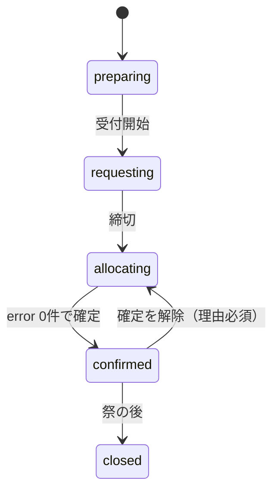

# データ設計

## 列挙型

Postgres の enum 型として作り、TypeScript の型は `supabase gen types` で生成する。団体代表はロールではなく、group_members の行で表す。

```sql
create type year_status as enum ('preparing','requesting','allocating','confirmed','closed');
create type group_category as enum ('stall','department','company','rest_area');
create type room_kind as enum ('room','gym','outdoor','other');
create type app_role as enum ('admin','staff','viewer');
create type rule_kind as enum ('substitute','source_restrict','fixed_request','keep');
create type alloc_origin as enum ('auto','manual');
create type consent_status as enum ('not_asked','asked','accepted','declined');
create type festival_day as enum ('day_minus2','day_minus1','day1','day2');
create type delivery_kind as enum ('furniture','tent','weight','side_curtain');
create type delivery_status as enum ('pending','done','problem');
```

| 型 | 値 | 表示名 |
| --- | --- | --- |
| year_status | preparing / requesting / allocating / confirmed / closed | 準備中 / 申請受付中 / 振り分け中 / 確定 / 終了 |
| group_category | stall / department / company / rest_area | 模擬店 / 部門 / 企業 / 休憩所 |
| room_kind | room / gym / outdoor / other | 部屋 / 体育館 / 屋外 / その他 |
| app_role | admin / staff / viewer | 総務管理者 / 総務部員 / 閲覧のみ |
| rule_kind | substitute / source_restrict / fixed_request / keep | 代替 / 運び元の制限 / 固定の申請 / 残す |
| alloc_origin | auto / manual | 自動 / 手動 |
| consent_status | not_asked / asked / accepted / declined | 未依頼 / 依頼済み / 了承 / 拒否 |
| festival_day | day_minus2 / day_minus1 / day1 / day2 | 前々日 / 前日 / 1日目 / 2日目 |
| delivery_kind | furniture / tent / weight / side_curtain | 机等 / テント / 重し / 三方幕 |
| delivery_status | pending / done / problem | 未 / 済 / 問題あり |

## テーブル定義

最初のマイグレーション（`supabase/migrations/0001_init.sql`）はこのDDLを元にする。created_at・updated_at は全テーブルに付ける（下では省略）。日時は timestamptz で保存し、画面では Asia/Tokyo で入力・表示する。

```sql
-- 年度
create table years (
  id uuid primary key default gen_random_uuid(),
  label text not null unique,                 -- 'R9'
  festival_start date not null,               -- 1日目
  request_open_at timestamptz,
  request_close_at timestamptz,
  status year_status not null default 'preparing'
);

-- 場所（年度をまたぐ）
create table rooms (
  id uuid primary key default gen_random_uuid(),
  name text not null unique,                  -- '第一多目的室'
  aliases text[] not null default '{}',
  kind room_kind not null default 'room',     -- 体育館は gym、外N・正門周辺は outdoor
  building text,                              -- '1号棟'。outdoor は null
  floor smallint,                             -- outdoor は null
  is_storage boolean not null default false,  -- 在庫を数える保管場所か
  extra_cost smallint not null default 0,     -- 運び出しにくい部屋の追加コスト（CI5 など）
  sort_order int not null default 0
);

-- 年度ごとの場所の状態（行がなければ使用可）
create table room_years (
  year_id uuid references years on delete cascade,
  room_id uuid references rooms,
  usable boolean not null default true,
  note text,
  primary key (year_id, room_id)
);

-- 品目（年度をまたぐ）
create table items (
  id uuid primary key default gen_random_uuid(),
  code text not null unique,                  -- 'desk'
  name text not null,                         -- '机(木)'
  aliases text[] not null default '{}',       -- フォームでの表記 '{机(キャスター有)}'
  requestable_categories group_category[] not null, -- 申請できる区分。不可机・不可椅子は '{}'
  sort_order int not null
);

-- 在庫
create table stocks (
  year_id uuid references years on delete cascade,
  room_id uuid references rooms,
  item_id uuid references items,
  count int not null check (count >= 0),
  counted_by uuid references auth.users,
  counted_at timestamptz,
  primary key (year_id, room_id, item_id)
);

-- 団体
create table groups (
  id uuid primary key default gen_random_uuid(),
  year_id uuid not null references years on delete cascade,
  name text not null,                         -- '2年2組'
  display_name text,                          -- '2年2組（カジノ）'
  aliases text[] not null default '{}',       -- '{展示部門(2-2)}'
  category group_category not null,
  is_food boolean not null default false,
  location_room_id uuid references rooms,     -- 使用場所。屋内・屋外は rooms.kind で判断。校内分散（美化など）は null
  sort_order int not null default 0,
  unique (year_id, name)
);

-- 年度ごとのロール（総務・閲覧のみ）
create table year_roles (
  year_id uuid references years on delete cascade,
  user_id uuid references auth.users on delete cascade,
  role app_role not null,
  primary key (year_id, user_id)
);

-- 団体代表（1人で複数団体を持てる）
create table group_members (
  group_id uuid references groups on delete cascade,
  user_id uuid references auth.users on delete cascade,
  primary key (group_id, user_id)
);

-- 招待（1人に複数作れる）
create table invitations (
  id uuid primary key default gen_random_uuid(),
  year_id uuid not null references years on delete cascade,
  email text not null check (email = lower(email)),
  role app_role,                              -- 総務・閲覧のみとして招待するとき
  group_id uuid references groups on delete cascade, -- 団体代表として招待するとき
  used_at timestamptz,
  check (role is not null or group_id is not null)
);
create index on invitations (email);

-- 申請の提出（団体ごとに1つ）
create table request_submissions (
  group_id uuid primary key references groups on delete cascade,
  submitted_at timestamptz,                   -- 未提出は null
  note text,                                  -- 備考（数には影響しない）
  updated_by uuid references auth.users
);

-- 申請（品目ごとの数）
create table requests (
  group_id uuid references groups on delete cascade,
  item_id uuid references items,
  count int not null check (count >= 0),
  primary key (group_id, item_id)
);

-- ルール
create table rules (
  id uuid primary key default gen_random_uuid(),
  year_id uuid not null references years on delete cascade,
  code text not null,                         -- 'S05'
  kind rule_kind not null,
  params jsonb not null,                      -- 形は03_allocation.md
  enabled boolean not null default true,
  memo text,
  unique (year_id, code)
);

-- 代替の了承（キャスター机交換など）
create table substitution_consents (
  group_id uuid references groups on delete cascade,
  from_item_id uuid references items,
  to_item_id uuid references items,
  count int,                                  -- 依頼したときの置き換え台数（団体に見せる）
  status consent_status not null default 'not_asked',
  note text,
  primary key (group_id, from_item_id, to_item_id)
);

-- 振り分け（振り分け表の1行）
create table allocations (
  id uuid primary key default gen_random_uuid(),
  year_id uuid not null references years on delete cascade,
  source_room_id uuid not null references rooms,
  group_id uuid not null references groups on delete cascade,
  item_id uuid not null references items,           -- 実際に運ぶ品目
  requested_item_id uuid not null references items, -- 申請した品目（代替がなければ item_id と同じ）
  count int not null check (count > 0),
  is_keep boolean not null default false,     -- 残す（運び元＝団体の使用場所）
  pinned boolean not null default false,      -- 自動実行で変えない
  origin alloc_origin not null,
  note text                                   -- 特記事項のみ
);
create index on allocations (year_id, item_id, source_room_id);
create index on allocations (year_id, group_id);

-- 建物間の距離コストの上書き（年度をまたぐ）
create table distance_overrides (
  building_a text not null,
  building_b text not null,
  cost smallint not null check (cost >= 0),
  primary key (building_a, building_b)
);

-- 時間枠と受け渡し（フェーズ2）
create table slots (
  id uuid primary key default gen_random_uuid(),
  year_id uuid not null references years on delete cascade,
  day festival_day not null,
  starts_at time,
  ends_at time,
  label text not null                         -- '前日 9:00〜9:15'、'仕分け時'
);

create table deliveries (                     -- 団体×種類ごとの受け渡し。振り分けの行とは切り離す
  id uuid primary key default gen_random_uuid(),
  year_id uuid not null references years on delete cascade,
  group_id uuid not null references groups on delete cascade,
  kind delivery_kind not null,
  slot_id uuid references slots,
  team smallint,
  status delivery_status not null default 'pending',
  problem_note text,
  returned boolean not null default false,
  checked_by uuid references auth.users,
  checked_at timestamptz,
  unique (group_id, kind)
);

-- ユーザーと履歴
create table profiles (
  user_id uuid primary key references auth.users on delete cascade,
  display_name text not null
);

create table audit_logs (
  id bigint generated always as identity primary key,
  table_name text not null,
  row_pk jsonb not null,
  action text not null,                       -- insert / update / delete
  before jsonb,
  after jsonb,
  reason text,
  user_id uuid,
  at timestamptz not null default now()
);

-- 余り（RLS を素通りしないよう security_invoker。使用不可の部屋は含めない）
create view v_remaining with (security_invoker = true) as
  select s.year_id, s.room_id, s.item_id, s.count as stock,
         coalesce(sum(a.count), 0) as allocated,
         s.count - coalesce(sum(a.count), 0) as remaining
  from stocks s
  left join room_years ry on ry.year_id = s.year_id and ry.room_id = s.room_id
  left join allocations a
    on a.year_id = s.year_id and a.source_room_id = s.room_id and a.item_id = s.item_id
  where coalesce(ry.usable, true)
  group by s.year_id, s.room_id, s.item_id, s.count;
```

**設計上の決めごと**

- 余りは保存しない。v_remaining で毎回計算する
- 残すは allocations の is_keep = true の行。「運び元＝団体の使用場所」は CHECK ではなくトリガーで確かめる（他の表を参照する CHECK は PostgreSQL が対応しておらず、ダンプからの復元も失敗し得る）。検証 E005 でも確かめる
- 使用不可の部屋は allocations を作らず、Excel 出力で「残す／使用不可」の行として出す
- 理由が要る書き込み（締切後の申請修正、手での振り分け変更、確定と確定解除）と、複数の表をまとめて変える書き込み（自動振り分けの保存、年度の複製、了承の記録）は、すべて DB 関数（RPC）で行う。関数の中で権限を確かめ、`set_config('app.reason', reason, true)` で理由を置いてから同じトランザクションで書き込む。PostgREST は1リクエストを1トランザクションで処理するので、別の呼び出しで置いた理由は届かない
- audit_logs は stocks・requests・request_submissions・rules・allocations・substitution_consents・years・year_roles のトリガーで書く。トリガーは `current_setting('app.reason', true)` で理由を読む
- 前年度の複製（フェーズ1、RPC `create_year_from`）は、groups・rules・room_years を新しい year_id で作り直す。rules.params の団体 id は、名前が同じ新しい団体に付け替える。付け替えられなかったルールは無効にして memo に理由を書く。stocks・requests・allocations・year_roles・invitations は複製しない（休憩所の申請は、前年の数を画面で初期値として出す）
- 同じ行を複数の管理者が同時に変えないよう、allocations と requests の更新は updated_at を条件に入れた楽観ロックにする。合わなければ「他の人が変更しました」と出して読み直す

## 権限とRLS

全テーブルで RLS を有効にする。ロールは関数 `private.has_role(year_id, role)`（year_roles を読む）と `private.is_group_member(group_id)`（group_members を読む）で判定する。どちらも SECURITY DEFINER、`search_path = ''`、公開しないスキーマ private に置き、ポリシーの中で表を読んでも再帰しないようにする。アプリが使う鍵は publishable キーだけで、secret（旧 service_role）キーは使わない。

R＝読み取り、W＝追加・更新・削除、RPC＝DB 関数経由でだけ書ける、—＝不可。招待されていない人は、自分の profiles 以外は何も読めない。

| テーブル | admin | staff | 団体代表 | viewer |
| --- | --- | --- | --- | --- |
| years | R・RPC | R | R | R |
| rooms・items・room_years・distance_overrides | RW | R | R | R |
| stocks | RW | RW（status が preparing / requesting のとき） | — | — |
| v_remaining | R | R | — | — |
| groups | RW | R | R（自団体） | R |
| year_roles・group_members・invitations | R・RPC | — | R（自分の行） | R（自分の行） |
| request_submissions・requests | RW（締切後は RPC） | R | RW（自団体・requesting・締切前） | — |
| rules | RW | R | — | — |
| substitution_consents | R・RPC | R | R（自団体）・RPC | — |
| allocations | R・RPC | R | R（自団体・confirmed 以降） | R（confirmed 以降） |
| slots | RW | R | R | R |
| deliveries | RW | R・RPC | R（自団体） | R |
| profiles | R | R（表示名） | R（自分） | R（自分） |
| audit_logs | R | — | — | — |

- allocations は誰にも直接の書き込みを許さない。すべて RPC で書き、確定中は RPC がエラーを返すので、確定後の書き込みは確実に止まる
- deliveries の「状態・問題・返却だけ更新できる」は、RLS ではなく RPC `check_delivery` で実現する（RLS は列を制限できない）
- ログインは Supabase Auth の Google プロバイダー。学校のドメイン以外は Before User Created フック（Postgres 関数）で拒否する。許可するドメインは関数の中に定数で書く。Google は組織の判定に hd クレームを使うよう求めているので、フックの入力に hd が含まれるかを T04 で確かめ、含まれなければメールのドメインで判定する
- 招待の受け入れは、auth.users への追加時のトリガー（SECURITY DEFINER）で行う。profiles を作り、メールが一致する未使用の invitations から year_roles と group_members を作る。すでにアカウントがある人を招待したときは、RPC `invite` の中でその場で同じ処理をする。メールは小文字にそろえて比べる
- 学校の Google Workspace では、18歳未満に指定された利用者は、管理者が許可していない外部アプリにログインできない。1〜3年生が使えるかは情報担当への確認待ち（[概要](00_overview.md) の未決事項）
- RLS と RPC の権限は pgTAP（`supabase test db`）でロールごとにテストする

## 年度ステータスの状態遷移

状態は管理者が RPC `set_year_status(year_id, to, reason)` で進める。関数の中で admin を確かめ、理由を audit_logs に書く。締切日時を過ぎても自動では進めない（締切後の申請の書き込みは RLS で止める）。



図にない遷移はエラーにする。confirmed へは、DB の中で在庫超過（E001）・使用不可からの振り分け（E002）・残すの不整合（E005）がないことを確かめてから進める。確定を解除すると理由が必須で、団体への公開も止まる。
