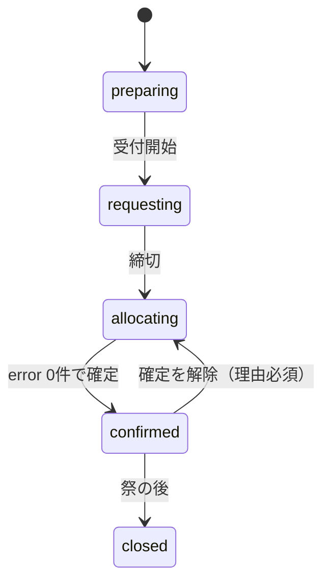

# データ設計

## 列挙型

Postgres の enum 型として作り、TypeScript の型は `supabase gen types` で生成する。団体代表はロールではなく、group_members の行で表す。

```sql
create type year_status as enum ('preparing','requesting','allocating','confirmed','closed');
create type group_category as enum ('stall','department','company','rest_area');
create type room_kind as enum ('room','gym','outdoor','other');
create type app_role as enum ('admin','staff','viewer');
create type rule_kind as enum ('substitute','source_restrict','fixed_request','keep');
create type alloc_origin as enum ('auto','manual');
create type consent_status as enum ('not_asked','asked','accepted','declined');
create type festival_day as enum ('day_minus2','day_minus1','day1','day2');
create type delivery_kind as enum ('furniture','tent','weight','side_curtain');
create type delivery_status as enum ('pending','done','problem');
```

| 型 | 値 | 表示名 |
| --- | --- | --- |
| year_status | preparing / requesting / allocating / confirmed / closed | 準備中 / 申請受付中 / 振り分け中 / 確定 / 終了 |
| group_category | stall / department / company / rest_area | 模擬店 / 部門 / 企業 / 休憩所 |
| room_kind | room / gym / outdoor / other | 部屋 / 体育館 / 屋外 / その他 |
| app_role | admin / staff / viewer | 総務管理者 / 総務部員 / 閲覧のみ |
| rule_kind | substitute / source_restrict / fixed_request / keep | 代替 / 運び元の制限 / 固定の申請 / 残す |
| alloc_origin | auto / manual | 自動 / 手動 |
| consent_status | not_asked / asked / accepted / declined | 未依頼 / 依頼済み / 了承 / 拒否 |
| festival_day | day_minus2 / day_minus1 / day1 / day2 | 前々日 / 前日 / 1日目 / 2日目 |
| delivery_kind | furniture / tent / weight / side_curtain | 机等 / テント / 重し / 三方幕 |
| delivery_status | pending / done / problem | 未 / 済 / 問題あり |

## テーブル定義

マイグレーションは supabase/migrations に4桁の連番で置く。0001_init.sql（列挙型・表・ビュー）と 0002_triggers.sql（トリガー）は T02、0003〜0006（権限の関数・RLS・RPC）は T03、0007_auth.sql（auth.users のトリガーと Before User Created フック）は T04、0008_confirm_keep_both_ways.sql（確定の前の確認の E005 を両方向にする）は T07、0009_apply_invitations_keep_conflict.sql（別のロールを持つ人へのロールの招待を使用済みにしない。remove_role で本人あての未使用のロールの招待も取り消す）は T03 のマージの後の直しで作る。本番に適用したファイルは書き換えず、次の番号のファイルを足す。created_at・updated_at は audit_logs を除く全テーブルに付け（下では省略）、トリガーで入れる（クライアントが送った値は使わない）。日時は timestamptz で保存し、画面では Asia/Tokyo で入力・表示する。

外部キーの on delete は次のとおりにする。年度・団体への参照は cascade（年度や団体を消すと、その下の行も消える）。場所・品目への参照は restrict（使われている場所・品目は消せない）。記録のためのユーザーへの参照（counted_by、updated_by、checked_by）は set null。年度と団体の両方を持つ表（allocations、deliveries、invitations）は、複合外部キー `(group_id, year_id) → groups (id, year_id)` で年度の一致を保証する。

文字列と数には上限を付ける。自由記述（note・memo・problem_note）は 2000 字、名前・表示名・ラベルは 100 字（年度名は 50 字）、コードと建物は 50 字、aliases は 20 個・合計 1000 字、rules.params は 20000 字、数（count）は 10000 まで。団体代表と部員も書ける列があるので、大きな値で無料プランの容量（500MB）を使い切らせず、解けない申請を入れさせないため。

```sql
-- 年度
create table years (
  id uuid primary key default gen_random_uuid(),
  label text not null unique check (btrim(label) <> '' and length(label) <= 50), -- 'R9'
  festival_start date not null check (festival_start between '2000-01-01' and '2200-12-31'), -- 1日目（有限で現実的な範囲。D-18）
  request_open_at timestamptz,
  request_close_at timestamptz,               -- 受付開始の前に入れる。requesting の間は null にできない
  status year_status not null default 'preparing',
  allocation_version int not null default 0,  -- 振り分けの入力と結果の版。allocating の間、関係する表が変わるたびにトリガーで増やす
  auto_allocated_at timestamptz,              -- 最後に自動振り分けを保存した日時
  prev_year_id uuid references years on delete set null, -- 複製元の年度（create_year_from が入れる）
  check (request_open_at is null or request_close_at is null or request_open_at < request_close_at)
);

-- 場所（年度をまたぐ）
create table rooms (
  id uuid primary key default gen_random_uuid(),
  name text not null unique check (btrim(name) <> '' and length(name) <= 100), -- '第一多目的室'
  aliases text[] not null default '{}' check (cardinality(aliases) <= 20 and length(array_to_string(aliases, '')) <= 1000),
  kind room_kind not null default 'room',     -- 体育館は gym、外N・正門周辺は outdoor
  building text check (length(building) <= 50), -- '1号棟'。outdoor は null
  floor smallint,                             -- outdoor は null
  is_storage boolean not null default false,  -- 在庫を数える保管場所か
  extra_cost smallint not null default 0 check (extra_cost between 0 and 20), -- 運び出しにくい部屋の追加コスト（CI5 など）。allocator の入力と同じ 0〜20
  sort_order int not null default 0
);

-- 年度ごとの場所の状態（行がなければ使用可）
create table room_years (
  year_id uuid references years on delete cascade,
  room_id uuid references rooms on delete restrict,
  usable boolean not null default true,
  note text check (length(note) <= 2000),
  primary key (year_id, room_id)
);

-- 品目（年度をまたぐ）
create table items (
  id uuid primary key default gen_random_uuid(),
  code text not null unique check (code ~ '^[a-z][a-z0-9_]*$' and length(code) <= 50), -- 'desk'。年度をまたぐキー
  name text not null check (btrim(name) <> '' and length(name) <= 100), -- '机(木)'
  aliases text[] not null default '{}' check (cardinality(aliases) <= 20 and length(array_to_string(aliases, '')) <= 1000), -- フォームでの表記 '{机(キャスター有)}'
  requestable_categories group_category[] not null default '{}', -- 申請できる区分。不可机・不可椅子は '{}'
  sort_order int not null
);

-- 在庫
create table stocks (
  year_id uuid references years on delete cascade,
  room_id uuid references rooms on delete restrict,
  item_id uuid references items on delete restrict,
  count int not null check (count between 0 and 10000),
  counted_by uuid references auth.users on delete set null, -- 書き込みのたびに DB が auth.uid() を入れる（counted_at も）
  counted_at timestamptz,
  primary key (year_id, room_id, item_id)
);

-- 団体
create table groups (
  id uuid primary key default gen_random_uuid(),
  year_id uuid not null references years on delete cascade,
  name text not null check (btrim(name) <> '' and length(name) <= 100), -- '2年2組'
  display_name text check (length(display_name) <= 100), -- '2年2組（カジノ）'
  aliases text[] not null default '{}' check (cardinality(aliases) <= 20 and length(array_to_string(aliases, '')) <= 1000), -- '{展示部門(2-2)}'
  category group_category not null,
  is_food boolean not null default false,
  location_room_id uuid references rooms on delete restrict, -- 使用場所。屋内・屋外は rooms.kind で判断。校内分散（美化など）は null
  sort_order int not null default 0,
  unique (year_id, name),
  unique (id, year_id)                        -- 年度の一致を複合外部キーで保証するための参照先
);

-- 年度ごとのロール（総務・閲覧のみ）
create table year_roles (
  year_id uuid references years on delete cascade,
  user_id uuid references auth.users on delete cascade,
  role app_role not null,
  primary key (year_id, user_id)
);
create index on year_roles (user_id);

-- 団体代表（1人で複数団体を持てる）
create table group_members (
  group_id uuid references groups on delete cascade,
  user_id uuid references auth.users on delete cascade,
  primary key (group_id, user_id)
);
create index on group_members (user_id);

-- 招待（1人に複数作れる。1行に1つの権限）
create table invitations (
  id uuid primary key default gen_random_uuid(),
  year_id uuid not null references years on delete cascade,
  email text not null check (email = lower(btrim(email)) and email ~ '^[^@[:space:]]+@[^@[:space:]]+$' and length(email) <= 254),
  role app_role,                              -- 総務・閲覧のみとして招待するとき
  group_id uuid,                              -- 団体代表として招待するとき
  used_at timestamptz,
  check ((role is null) <> (group_id is null)), -- 1行に1つ。両方なら2行作る
  foreign key (group_id, year_id) references groups (id, year_id) on delete cascade
);
create index on invitations (email);
create index on invitations (group_id);
-- 未使用の招待は（年度・メール）にロール1つ、（年度・メール・団体）に1つ
create unique index on invitations (year_id, email) where role is not null and used_at is null;
create unique index on invitations (year_id, email, group_id) where group_id is not null and used_at is null;

-- 申請の提出（団体ごとに1つ）
create table request_submissions (
  group_id uuid primary key references groups on delete cascade,
  submitted_at timestamptz,                   -- 未提出は null。提出のたびに DB が now() にする（CSV の取り込みで admin が submittedAt を渡したときを除く。D-19）
  note text check (length(note) <= 2000),     -- 備考（数には影響しない）
  updated_by uuid references auth.users on delete set null -- DB が auth.uid() を入れる
);

-- 申請（品目ごとの数）
create table requests (
  group_id uuid references groups on delete cascade,
  item_id uuid references items on delete restrict,
  count int not null check (count between 0 and 10000),
  primary key (group_id, item_id)
);

-- ルール
create table rules (
  id uuid primary key default gen_random_uuid(),
  year_id uuid not null references years on delete cascade,
  code text not null check (btrim(code) <> '' and length(code) <= 50), -- 'S05'
  kind rule_kind not null,
  params jsonb not null check (jsonb_typeof(params) = 'object' and length(params::text) <= 20000), -- 形は03_allocation.md
  enabled boolean not null default true,
  memo text check (length(memo) <= 2000),
  unique (year_id, code)
);

-- 代替の了承（キャスター机交換など）
create table substitution_consents (
  group_id uuid references groups on delete cascade,
  from_item_id uuid references items on delete restrict,
  to_item_id uuid references items on delete restrict,
  count int check (count between 0 and 10000), -- 依頼したときの置き換え台数（団体に見せる）。set_consent で asked にしたとき RPC が入れる
  status consent_status not null default 'not_asked',
  note text check (length(note) <= 2000),
  primary key (group_id, from_item_id, to_item_id),
  check (from_item_id <> to_item_id)
);

-- 振り分け（振り分け表の1行）
create table allocations (
  id uuid primary key default gen_random_uuid(),
  year_id uuid not null references years on delete cascade,
  source_room_id uuid not null references rooms on delete restrict,
  group_id uuid not null,
  item_id uuid not null references items on delete restrict,           -- 実際に運ぶ品目
  requested_item_id uuid not null references items on delete restrict, -- 申請した品目（代替がなければ item_id と同じ）
  count int not null check (count between 1 and 10000),
  is_keep boolean not null default false,     -- 残す（運び元＝団体の使用場所）。保存する RPC が決める
  pinned boolean not null default false,      -- 自動実行で変えない
  origin alloc_origin not null,
  note text check (length(note) <= 2000),     -- 特記事項のみ
  foreign key (group_id, year_id) references groups (id, year_id) on delete cascade -- 年度の一致
);
create index on allocations (year_id, item_id, source_room_id);
create index on allocations (year_id, group_id);

-- 建物間の距離コストの上書き（年度をまたぐ）
create table distance_overrides (
  building_a text not null check (length(building_a) <= 50),
  building_b text not null check (length(building_b) <= 50),
  cost smallint not null check (cost between 0 and 20), -- allocator の入力と同じ 0〜20
  primary key (building_a, building_b),
  check (building_a collate "C" < building_b collate "C") -- 建物の組は向きを持たない。トリガーが C の照合順序（コードポイント順）で小さい方を building_a に入れ替える
);

-- 時間枠と受け渡し（フェーズ2）
create table slots (
  id uuid primary key default gen_random_uuid(),
  year_id uuid not null references years on delete cascade,
  day festival_day not null,
  starts_at time,
  ends_at time,
  label text not null check (btrim(label) <> '' and length(label) <= 100), -- '前日 9:00〜9:15'、'仕分け時'
  unique (id, year_id),
  check (starts_at is null or ends_at is null or starts_at < ends_at)
);

create table deliveries (                     -- 団体×種類ごとの受け渡し。振り分けの行とは切り離す
  id uuid primary key default gen_random_uuid(),
  year_id uuid not null references years on delete cascade,
  group_id uuid not null,
  kind delivery_kind not null,
  slot_id uuid,
  team smallint check (team between 1 and 100),
  status delivery_status not null default 'pending',
  problem_note text check (length(problem_note) <= 2000),
  returned boolean not null default false,
  checked_by uuid references auth.users on delete set null,
  checked_at timestamptz,
  unique (group_id, kind),
  foreign key (group_id, year_id) references groups (id, year_id) on delete cascade,
  foreign key (slot_id, year_id) references slots (id, year_id) on delete set null (slot_id) -- 時間枠を消しても受け渡しは残す
);

-- ユーザーと履歴
create table profiles (
  user_id uuid primary key references auth.users on delete cascade,
  display_name text not null check (length(display_name) <= 100) -- Google の氏名。なければ「名前未設定」（メールからは作らない）
);

create table audit_logs (
  id bigint generated always as identity primary key,
  table_name text not null,
  row_pk jsonb not null,                      -- 主キーの列を JSON にしたもの
  action text not null check (action in ('insert','update','delete')),
  year_id uuid,                               -- 履歴の絞り込み用（外部キーなし。消えた行の記録も残す）
  group_id uuid,
  before jsonb,
  after jsonb,
  reason text,
  user_id uuid,
  at timestamptz not null default now()
);
create index on audit_logs (year_id, at desc);
create index on audit_logs (table_name, at desc);
create index on audit_logs (group_id, at desc) where group_id is not null;

-- 余り（RLS を素通りしないよう security_invoker。使用不可の部屋は含めない）
create view v_remaining with (security_invoker = true) as
  select s.year_id, s.room_id, s.item_id, s.count as stock,
         coalesce(sum(a.count), 0)::int as allocated,
         (s.count - coalesce(sum(a.count), 0))::int as remaining
  from stocks s
  left join room_years ry on ry.year_id = s.year_id and ry.room_id = s.room_id
  left join allocations a
    on a.year_id = s.year_id and a.source_room_id = s.room_id and a.item_id = s.item_id
  where coalesce(ry.usable, true)
  group by s.year_id, s.room_id, s.item_id, s.count;
```

**設計上の決めごと**

- 余りは保存しない。v_remaining で毎回計算する
- 残すは allocations の is_keep = true の行。is_keep は「運び元＝団体の使用場所」と一致させる（残す ⇔ 運び元が使用場所）。is_keep は、保存する RPC が「運び元＝団体の使用場所」かどうかで決める（クライアントの値は使わない）。「is_keep の行の運び元＝団体の使用場所」は CHECK ではなくトリガーで確かめる（他の表を参照する CHECK は PostgreSQL が対応しておらず、ダンプからの復元も失敗し得る）。逆向き（使用場所からの行が残すでない）はトリガーでは止めず、保存の RPC が決め直して直す（RPC で書いた行はいつもそろう）。振り分けの後に団体の使用場所を変えると、どちらの向きにもずれ得るので、確定では両方向の不一致（残すなのに運び元が使用場所でない／使用場所からの行が残すでない）を検証 E005 として確かめる（`private.confirm_issues`）。年度の一致（行の year_id と団体の year_id）は複合外部キーで保証する
- 使用不可の部屋は allocations を作らず、Excel 出力で「残す／使用不可」の行として出す
- 理由が要る書き込み（締切後の申請修正、手での振り分け変更、確定と確定解除）と、複数の表をまとめて変える書き込み（自動振り分けの保存、年度の複製、了承の記録、申請の提出）は、すべて DB 関数（RPC）で行う。関数の中で権限を確かめ、`set_config('app.reason', reason, true)` で理由を置いてから同じトランザクションで書き込む。PostgREST は1リクエストを1トランザクションで処理するので、別の呼び出しで置いた理由は届かない
- audit_logs は stocks・requests・request_submissions・rules・allocations・substitution_consents・years・year_roles と、room_years・groups・group_members・rooms・items・distance_overrides のトリガーで書く。invitations（メール）と profiles（氏名）は個人情報を写さないため記録しない。トリガー関数は SECURITY DEFINER・`search_path = ''` にする（audit_logs には誰にも書き込みの権限を与えないので、部員の在庫入力などで失敗しないように）。トリガーは `current_setting('app.reason', true)` で理由を、`auth.uid()` で書いた人を読む。row_pk は主キーの列を JSON にしたもの、before・after は行全体。updated_at・版の列（allocation_version）・auto_allocated_at しか変わらない更新は記録しない（auto_allocated_at は自動振り分けの保存で allocations の行と一緒に変わり、その行が監査に残るため）。year_id・group_id は行から入れ（year_id を持たない表は団体から引く）、団体の連鎖削除で消えた行にも、消える前の団体の年度を入れる
- 申請できる品目はトリガーで確かめる。数が1以上で、品目の「申請できる区分」に団体の区分がなければ E006 で拒否する。ただし企業以外の長机(3人掛)は通す（前処理で長机(2人掛)に読み替える。D-05）
- stocks の counted_by・counted_at と、request_submissions の updated_by・submitted_at は、ログインしている人が書いたときにトリガーで入れる（クライアントが送った値は使わない）。例外は、admin だけが呼べる RPC `update_requests_after_deadline` が CSV の取り込みでフォームのタイムスタンプ（submittedAt）を渡したときの submitted_at で、RPC がその書き込みの間だけ transaction-local の設定（`app.keep_submitted_at`）を立て、トリガーは値を置き換えない（団体代表は日時を偽れない。D-19）
- distance_overrides の建物の組は向きを持たない。呼ぶ側が順序を気にしなくてよいよう、トリガーが C の照合順序（コードポイント順。DB の既定の照合順序や JavaScript の並べ替えに依存しない）で小さい方を building_a に入れ替える。同じ建物どうしは CHECK で拒否する
- rules.year_id は作った後に変えられない（トリガーで拒否する。ルールを閉じた年度へ移す抜け道を、ポリシーに頼らず DB で止める）
- 行を別の年度・団体へ動かす更新も止める。確定中・closed の守りと版の増分は新しい行の年度しか見ないので、動かせると確定中の年度から振り分けを抜き出せるため。年度を持つ表の year_id（room_years・stocks・groups・year_roles・invitations・allocations・slots・deliveries）と、団体を主キーに含む表の group_id（group_members・request_submissions・requests・substitution_consents）は、作った後に変えられない（トリガー `check_immutable`。`invalid_input`）。allocations・deliveries・invitations の group_id は、複合外部キーで year_id と対になっているので、同じ年度の別の団体にだけ変えられる
- anon と PUBLIC には、public・private スキーマの表・ビュー・シーケンス・関数の権限を何も与えない（PUBLIC への既定の execute も外す）。authenticated には、「権限とRLS」の表の権限（全表の select と、W の表の insert・update・delete）、RPC の execute、ポリシーが呼ぶ private の判定関数の execute と private の usage だけを与える。シーケンスの権限は誰にも与えない（audit_logs は SECURITY DEFINER のトリガーだけが書く）。pgTAP が has_*_privilege で全オブジェクトを棚卸しして、一覧と比べる
- 前年度の複製（フェーズ1、RPC `create_year_from`）は、groups・rules・room_years を新しい year_id で作り直し、呼んだ人を新しい年度の admin にする（year_roles に1行）。呼べるのは複製元の年度の admin だけで（複製元が closed でもよい）、複製元は最新の年度（それを複製元にした年度も、1日目が同じかそれより後の年度もない）に限る。新しい年度の1日目は複製元より後にする（update_year で1日目を変えるときも、複製元より後で、その年度を複製元にした年度より前でなければならない。崩すと、どの年度も最新でなくなり次の年度を作れなくなる）。1日目は有限で現実的な範囲（2000-01-01〜2200-12-31）に限る（years の CHECK。update_year・create_year_from は invalid_input（field: festival_start）を返す）。infinity や date の上限を入れた年度を closed にすると、それより後の1日目がなくなり、誰も次の年度を作れなくなるため（D-18）。古い年度の admin や、ほかの年度の admin が年度を作って権限を取り戻したり、ロールのない年度を複製して読んだりできないようにするため。新しい年度の prev_year_id に複製元を入れる。rules.params の団体 id（group・groups）は、名前が同じ新しい団体に付け替える。付け替えられなかったルールは無効にして memo に理由を書く。stocks・requests・allocations・substitution_consents・year_roles（呼んだ人以外）・invitations は複製しない（在庫入力の「前年の数」と休憩所の申請の初期値は、RPC `previous_year_stocks`・`previous_year_requests` で前年度の数を読んで出す）
- 最初の年度と最初の admin は、オーナーが一度アプリにログインしてから、管理画面の SQL Editor で years と year_roles に1行ずつ入れて作る。最新の年度の admin が誰も残っていないときも同じ方法で admin を足す。手順は README に書く。卒業する admin は、年度を closed にする前後に remove_role で外す（closed でも外せる）
- 同じ行を複数の管理者が同時に変えないよう、allocations と requests の更新は updated_at を条件に入れた楽観ロックにする。クライアントは受け取った updated_at の文字列をそのまま返し、DB はミリ秒までで比べる。合わなければ「他の人が変更しました」と出して読み直す
- 自動振り分けと確定は、years.allocation_version（振り分けの入力と結果の版）で、計算・検証している間に何かが変わっていないかを確かめる。年度が allocating の間に、allocate の入力になる表（stocks、room_years、groups、requests、request_submissions、rules、substitution_consents、allocations と、rooms・items・distance_overrides）が変わると、文ごとのトリガーで版が増える。状態を遷移したときも増える。画面は版をほかのデータより先に読み、入力を組み立てたときの版を save_auto_allocations と確定（set_year_status）に渡す。違えば conflict になって読み直す。書き込みの RPC は年度の行を `for no key update` でロックしてから書くので、同じ年度の保存は順に処理され、外部キーの確認（在庫の入力など）は待たされない
- 確定中（confirmed）と終了（closed）の年度では、確定済みのデータに E001・E002・E005 を作る直接の書き込みをトリガーで止める：団体の削除と、使用場所・区分・年度の変更、振り分けのある部屋を使用不可にすること、振り分けの合計より少ない在庫にすること。allocations の変更も止める（団体の連鎖削除と postgres からの書き込みを含む）。表示名・並び順・メモの変更と、在庫を増やす数え直しはできる。直すときは確定を解除する。トリガーは年度の行をロックしてから状態を読むので、確定と同時に走っても順に処理される。ロックは、allocating の間は版の増分と同じ強さ（`for no key update`）を最初から取り、それ以外は `for share` にする（allocating の間の管理者どうしの直接の書き込みがデッドロックせず、受付中の部員の在庫入力どうしは並行に進む）。BEFORE ROW のトリガーはポリシーの with check より先に動くので、トリガーは最初に「書いている人がその表に書けるか」をポリシーと同じ条件で確かめ、書けない人（anon・authenticated で、ポリシーが拒否する人）ではロックを取らずに拒否を RLS に任せる（拒否される insert を繰り返して admin の RPC を待たせられないように）
- closed の年度は読み取り専用にする。例外はルールの memo と、運搬・返却のチェックと、ロール・団体代表を外すこと（`remove_role`・`remove_group_member`）と未使用の招待の取り消し（`revoke_invitation`）だけで、「年間の業務の流れ」9 のとおりに運用でき、卒業した admin などの権限を残さない（ルールの memo はトリガーで memo 以外の変更を止める）

## 権限とRLS

全テーブルで RLS を有効にする。ロールは関数 `private.has_role(year_id, role)`（year_roles を読む）と `private.is_group_member(group_id)`（group_members を読む）で判定する。年度を持たない表（rooms・items・distance_overrides）の書き込みは `private.is_admin_of_open_year()`（状態が closed でない年度のどれかで admin。D-01）で、profiles の読み取りは `private.can_see_profile(user_id)`（自分と、自分が admin・staff である年度のメンバー）で判定する。ほかに、年度の状態・締切・団体の年度を引く関数を同じ場所に置く。どれも呼んだ人（auth.uid()）についてだけ答え、SECURITY DEFINER、`search_path = ''`、公開しないスキーマ private に置き、ポリシーの中で表を読んでも再帰しないようにする。アプリが使う鍵は publishable キーだけで、secret（旧 service_role）キーは使わない。

表の権限（grant）も権限表に合わせる。anon には何も与えない。authenticated には全表の select と、W の表の insert・update・delete だけを与え、RPC でだけ書く表（years・year_roles・group_members・invitations・substitution_consents・allocations・profiles・audit_logs）には書き込みの権限を与えない。RPC の execute は authenticated だけに与える。

R＝読み取り、W＝追加・更新・削除、RPC＝DB 関数経由でだけ書ける、—＝不可。招待されていない人は、自分の profiles 以外は何も読めない。

| テーブル | admin | staff | 団体代表 | viewer |
| --- | --- | --- | --- | --- |
| years | R・RPC | R | R（自団体の年度） | R |
| rooms・items・distance_overrides | RW（closed でない年度のどれかで admin） | R | R | R |
| room_years・slots | RW | R | R | R |
| stocks | RW | RW（status が preparing / requesting のとき） | — | — |
| v_remaining | R | R | — | — |
| groups | RW | R | R（自団体） | R |
| year_roles・group_members | R・RPC | R（自分の行） | R（自分の行） | R（自分の行） |
| invitations | R・RPC | R（自分のメールの行） | R（自分のメールの行） | R（自分のメールの行） |
| request_submissions・requests | RW（preparing と締切前。締切後は RPC） | R | RW・RPC（自団体・requesting・受付期間内） | — |
| rules | RW | R | — | — |
| substitution_consents | R・RPC | R | R（自団体）・RPC | — |
| allocations | R・RPC | R | R（自団体・confirmed 以降） | R（confirmed 以降） |
| deliveries | RW | R・RPC | R（自団体） | R |
| profiles | R（自分と、その年度のメンバー） | R（自分と、その年度のメンバー。表示名） | R（自分） | R（自分） |
| audit_logs | R（その年度の admin。年度のない行は、年度をまたぐ3表の分を closed でない年度の admin が読む） | — | — | — |

admin・staff・viewer は、その行の年度でのロールを指す（R9 の admin でも、R8 でロールがなければ R8 の行は読めない。前年度の数は RPC で読む）。「その年度のメンバー」は、その年度にロールか団体代表の行がある人。自分のメールの招待は、どこかの年度のロールか団体代表がある間だけ読める（外された人は読めない）。「自分のメール」は、本人のものと確かめられる今のメール（`private.verified_email`。下の招待の受け入れと同じ判定。ポリシーは自分の分だけを返す `private.my_verified_email()` を呼ぶ）で、JWT の email とは比べない（email を他人のアドレスに変えた状態で、その人あての未使用の招待を読ませないため。D-17a）。ロールと団体代表は兼ねられ、兼ねた人は両方の権限を持つ（例：staff が自団体の代表として申請を書く）。

状態が closed の年度は、どのロールも書き込めない（読み取り専用）。例外は、ルールの memo（admin）と、運搬・返却のチェック（RPC `check_delivery`、admin・staff）と、ロール・団体代表を外すことと未使用の招待の取り消し（RPC `remove_role`・`remove_group_member`・`revoke_invitation`、admin。卒業した admin などの権限を残さないため）。確定中（confirmed）は、「設計上の決めごと」の確定中の守りのとおり、確定済みのデータに error を作る書き込みができない。

- allocations は誰にも直接の書き込みを許さない。すべて RPC で書き、確定中は RPC がエラーを返す。団体の連鎖削除などで確定中・終了の年度の allocations が変わることも、トリガーが止める。これで確定後の書き込みは確実に止まる
- 締切前：団体代表が申請を書けるのは、status が requesting で、request_open_at が null か過ぎていて、now() が request_close_at より前のとき。request_close_at が null なら締切前とみなさない（書けない）。管理者が RPC なしで書けるのは、status が preparing のときと、requesting で締切前のとき。受付開始（requesting への遷移）は request_close_at が未来でなければエラーにする
- ポリシーの update は using と with check に同じ述語を書く。with check は更新後の行しか見られないので、「年度・団体を変えない」はトリガー（check_immutable、rules は guard_rules）で止める（「設計上の決めごと」）
- deliveries の「状態・問題・返却だけ更新できる」は、RLS ではなく RPC `check_delivery` で実現する（RLS は列を制限できない）
- ログインは Supabase Auth の Google プロバイダー（ブラウザの PKCE フロー）。Google 以外のプロバイダー（メールのサインアップなど）と、学校のドメイン以外は Before User Created フック（Postgres 関数 `private.hook_before_user_created`）で拒否する。関数は公開しないスキーマ private に置き、execute は supabase_auth_admin にだけ与える。許可するドメインは `g.kumamoto-nct.ac.jp`（D-04）で、関数 `private.school_domain()` の1か所に書き、フックはそれを呼ぶ（execute は supabase_auth_admin にだけ与える。テストはトランザクションの中でこの関数を予約済みのドメインを返すものに置き換えて、実在のドメインのメールアドレスを書かずに判定を確かめる）。フックの入力では、プロバイダーが `user.app_metadata.provider`、Google の hd クレームが `user.user_metadata.custom_claims.hd` に入る（GoTrue が ID トークンから hd を写す。userinfo で取ったときは入らない）。hd があれば hd とメールのドメインの両方、なければメールのドメインだけで判定する。拒否は HTTP 403 で、画面は「学校の Google アカウントでログインしてください」と出す。フックは GoTrue の API でユーザーを作るときだけ呼ばれ、seed・SQL Editor・管理 API での作成では呼ばれない
- 招待の受け入れは、auth.identities への追加時と、メールが確認済みになったとき（auth.users の email_confirmed_at が null から値に変わったとき）のトリガー（SECURITY DEFINER）で行う。GoTrue は Google のユーザーを未確認のまま追加し、identity を足してから同じトランザクションで確認済みにするので、Google のユーザーは後者で受け入れる。auth.users への追加時に profiles を作る（表示名は Google の氏名。なければ「名前未設定」で、メールからは作らない。100 字まで）。今のメールが本人のものと確かめられるアカウント（`private.verified_email`：削除されていない・メールを確認済み・メールの変更の途中でない、かつ auth.users.email と同じメールの、identity_data の email_verified が真（真偽値の true か文字列の "true"）の Google の identity か、email_verified が true（真偽値）の email の identity がある。Google の identity があるアカウントは Google の identity のメールだけを見る。email_confirmed_at は最初の確認の時刻で、メールを変えても null に戻らないため。D-17a）にだけ、メールが一致する未使用の invitations（closed でない年度）から year_roles と group_members を作って used_at を入れる（他人のメールを名乗った登録に招待を取らせない。すでにあるロールは上書きしない。その年度で別のロールを持つ人へのロールの招待は、used_at を入れずに未使用のまま残す。ロールを変えるなら管理者が `set_role` で変えるか、招待を取り消す）。監査の理由は「招待の受け入れ」。すでにアカウントがある人を招待したときは、RPC `invite` の中でその場で同じ処理（`private.apply_invitations`）をする（`private.verified_email` で確かめられるアカウントだけ）。その人がその年度で別のロールを持っていれば invite はエラーにし、ロールの変更は `set_role` で行う。`remove_role` でロールを外すと、その年度の本人（`private.verified_email` で確かめられるメール）あての未使用のロールの招待も取り消す（「外す」は外すだけにし、残っていた招待で次のログインに権限が戻らないようにする。団体代表の招待は消さない）。招待と初回ログインが行き違ったときのために、画面はログインのたびに RPC `accept_my_invitations` を呼ぶ。メールは小文字にそろえて比べる
- `private.verified_email` は二重目の守りで、本番の Auth の次の設定を前提にする（README の「4. ログイン」の 7「必ず守る Auth の設定」。D-17a）。外すと、ログイン済みの人が自分のメールを招待された人のアドレスに変えて、その人あての招待（admin を含む）を受け取れるおそれがある
  - **ログインは Google だけ**（Email・Phone・匿名のサインインは無効）。Google の identity のないアカウント（email だけ・電話・匿名）を作らせない。email だけのアカウントには「Google の identity のメールだけを見る」守りが効かず、下の2つの設定だけに頼る
  - **Confirm email** と **Secure email change** は有効。Confirm email が無効だと、GoTrue はメールの変更を古いアドレスに届いたリンクだけで終え、email の identity を新しいアドレスと email_verified: true に書き換えるか、新しく作る（Email プロバイダーを無効にしていても。Secure email change が有効でも）。email だけのアカウントはそれで他人の招待を取れる。Secure email change が無効だと、変更は新しいアドレスの確認だけで終わり、古いアドレスの持ち主に確かめない（盗まれたセッションからメールを付け替えられる）
  - **Allow manual linking** は無効。有効だと、利用者が identity を足したり外したりできる。Confirm email も無効だと、Google のユーザーがメールを変えて email の identity を作り（上）、Google の identity を外して email だけのアカウントになり、「Google の identity のメールだけを見る」守りを抜けて他人の招待を取れる（T03 の攻撃での確認）。無効なら Google のユーザーは Google の identity を外せないので、Confirm email が崩れても止まる
  - ローカルの supabase/config.toml も `enable_confirmations = true`・`double_confirm_changes = true`・`enable_manual_linking = false`・`enable_anonymous_sign_ins = false` にする（Email プロバイダーはテストユーザーのパスワードログインのためだけに有効）。本番は全員が Google の identity を持つので、Confirm email か Secure email change だけが崩れても「Google の identity のメールだけを見る」で止まる。Google の identity のない email だけのアカウント（ローカルのテストユーザー）は、Confirm email と Secure email change に頼る（既知の依存。D-17a）
- E2E・CI のテストユーザー（管理者・部員・団体代表・閲覧のみ・未招待）は supabase/seed.sql で auth.users と auth.identities に直接入れる（フックは通らないが、上のトリガーは動く）。年度・団体・招待を先に入れておき、email_confirmed_at を入れたユーザーと、同じメールで email_verified が true の email の identity を足して、identity の追加のトリガーでロールを付ける。メールは予約済みのドメイン（`@example.test`）、パスワードはローカル専用の固定値にする。seed は本番に流さず、本番ではメールログインを無効にする（D-02）。画面のメール＋パスワードのログインは、ビルド時のフラグがあり、Supabase がローカルのときだけ出る
- 学校の Google Workspace では、18歳未満に指定された利用者は、管理者が許可していない外部アプリにログインできない。1〜3年生が使えるかは情報担当への確認待ち（[概要](00_overview.md) の未決事項）
- RLS と RPC の権限は pgTAP（`supabase test db`）でロールごとにテストする。権限表の全セルは、期待値の表（表・操作・年度の状態・ペルソナごとの可否）から生成して確かめる。確定中の守りも、confirmed のセルとして確かめる。関数の execute と表の権限の棚卸し（anon が何も実行・参照できないこと、authenticated が実行できるのは RPC とポリシーの判定関数だけであること、supabase_auth_admin が実行できるのはフックと、フックが呼ぶ private.school_domain() だけであること）もテストする

## 年度ステータスの状態遷移

状態は管理者が RPC `set_year_status(year_id, to, reason, base_version)` で進める。関数の中で admin を確かめ、理由を audit_logs に書く（確定と確定の解除では理由が必須）。遷移のたびに years.allocation_version を増やす。締切日時を過ぎても自動では進めない（締切後の申請の書き込みは RLS で止める）。



図にない遷移はエラーにする。requesting へは、request_close_at が未来の日時で入っているときだけ進める。confirmed へは、理由と base_version（確定ボタンを押した画面が検証に使った版）が要る。版が今の版と違えば（検証の後に振り分けや入力が変わっていれば）エラーにする。そのうえで、DB の中で在庫超過（E001。固定・手動・残すの行を含む）・使用不可からの振り分け（E002）・is_keep と「運び元＝使用場所」の不一致（E005。両方向）がないことを確かめてから進める。warning（W102 の了承待ちを含む）では止めない。確定中は、確定済みのデータに error を作る書き込みをトリガーで止める（「設計上の決めごと」）。確定を解除すると理由が必須で、団体への公開も止まる。closed は終点で、closed の年度は読み取り専用になる（ルールの memo と、運搬・返却のチェック（`check_delivery`）と、ロール・団体代表を外すこと（`remove_role`・`remove_group_member`）と未使用の招待の取り消し（`revoke_invitation`）を除く。「設計上の決めごと」）。
